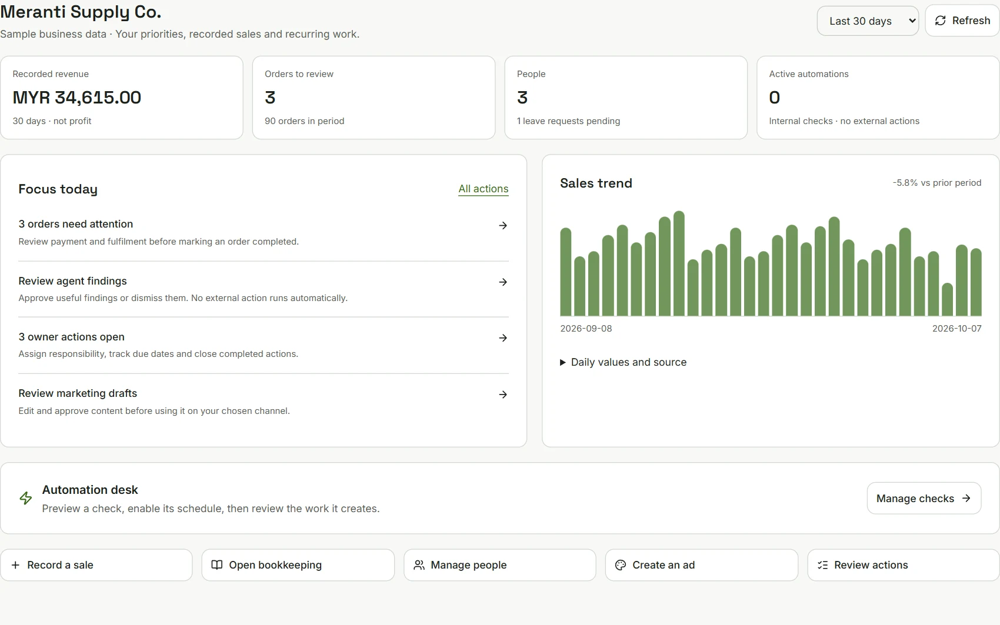
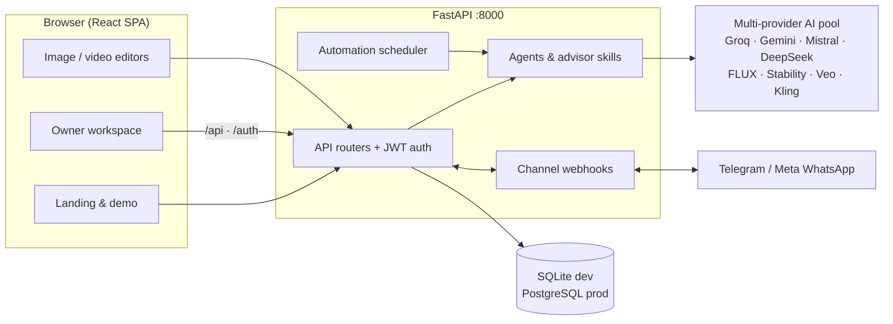

<div align="center">

# SME OS · SME Toolkit

**Run the business. Not the busywork.**

A business-owner workspace built with React, Vite and FastAPI: shared business context, recorded sales,
quotations & invoices, bookkeeping, people & HR, reviewable agent findings, marketing planning and an
advertising/creative studio.

[](https://github.com/nusabyte-my/sme-toolkit/actions/workflows/deploy.yml)
[](LICENSE)

React 19 · TypeScript · Vite · Tailwind CSS · FastAPI · SQLAlchemy · LangGraph



</div>

---

## Table of contents

- [What this is](#what-this-is)
- [Feature map](#feature-map)
- [Demo mode](#demo-mode)
- [Architecture](#architecture)
- [Tech stack](#tech-stack)
- [Quick start](#quick-start)
- [Configuration](#configuration)
- [Project structure](#project-structure)
- [Scripts & checks](#scripts--checks)
- [API overview](#api-overview)
- [AI provider system](#ai-provider-system)
- [Product tiers](#product-tiers)
- [Verification](#verification)
- [Deployment](#deployment)
- [Security notes](#security-notes)
- [Design and data boundaries](#design-and-data-boundaries)
- [Repository status](#repository-status)
- [License](#license)
- [Contact](#contact)

---

## What this is

SME Toolkit (SME OS) is a single-owner business workspace. The frontend is the product surface —
a commercial landing page plus a private owner workspace — and the backend is a FastAPI service that
holds business records, runs advisor/agent workflows, integrates messaging channels, and proxies
multi-provider AI generation.

Two principles drive the design:

- **Recorded data over invented data.** Sales, ledgers, invoices, employees and campaigns are persisted
  records scoped to the authenticated business. Research gaps and missing evidence stay visible.
- **Review before action.** Agents and automations produce proposals, tasks and drafts; money, messages,
  publishing and accounting postings are owner-approved actions, never autonomous.

Every demo dataset is clearly synthetic. **Meranti Supply Co. is fictional.**

## Feature map

| Area | What it does |
|---|---|
| **Dashboard** (`#/dashboard`) | Selectable reporting periods, recorded-sales trend, operating indicators, prioritized review work, quick actions |
| **Business profiles** (`#/profiles`) | One business per account: products, customers, goals, brand voice, verified proof points, constraints, currency, timezone |
| **Sales & CRM** (`#/sales`, `#/leads`) | Manual sales with status transitions, filters, CSV export / atomic CSV import (external order refs required); CRM contacts, stages, notes, follow-up deadlines |
| **Billing** (`#/billing`) | Customer records → numbered quotation drafts → immutable issue snapshots → acceptance/decline evidence → one invoice per accepted quotation → partial/full payments with reversal; escaped print view; issuing and payments post to bookkeeping |
| **Bookkeeping** (`#/bookkeeping`) | Chart of accounts, receipts/payments/transfers, balanced advanced journals, immutable posted entries, reversals, profit & loss / trial balance, CSV export, reconciled cash/bank locks |
| **People & HR** (`#/hr`) | Employee directory, departments, reporting lines, leave requests with allowance reservations, reversible onboarding tasks |
| **Agents** (`#/agent-forge`) | Persistent guided/AI agent conversations, reviewed creation, permitted tools, public channel facts, evidence schedules; agent proposals create tasks or draft documents only after owner approval |
| **Advisors** | 18 versioned specialist skills (Finance Readiness, Lead Follow-up, Fulfilment, Campaign Planner, Ad Efficiency, Creative QA, SEO Readiness, Research Quality, Execution Coach, Bookkeeping Review, People Review, Business Review, Sales, Operations, Marketing, Strategy, Ideation, Copywriting). Fourteen are deterministic rules; four use a text provider |
| **Automations** (`#/automations`) | Twelve paused-by-default checks (search, preview evidence, cadences, persistent activity); they create internal tasks and briefings only |
| **Creative studio** (`#/ads`, `#/content`, `#/visual`, `#/video`) | Copy engine (Direct/AIDA/PAS/BAB), canvas-first image editor with layers/export, timeline video editor (≤20 scenes / 120 s) with captions, SRT, WebM and FFmpeg MP4 export |
| **Ad optimization** (`#/ad-optimization`) | Daily manual/CSV campaign metrics, idempotent updates, CTR/CPC/CPA/CVR/ROAS with matched windows, owner targets, minimum-data gates; recommendations become review actions only |
| **Social & e-commerce** (`#/social`, `#/ecommerce`) | Campaign drafts with approval/archive flow; recorded channel revenue with an explicit import path and live-connection prerequisites |
| **Strategy tools** (`#/bmc`, `#/strategy`, `#/ideation`, `#/seo`, `#/market-research`, `#/quickwins`) | Nine-block canvases, decision records, testable idea briefs, metadata/JSON-LD, source-backed research notebooks — each with **Guided** and **Experienced** editing modes |
| **Channels** (`#/channels`) | Real Telegram Bot API / Meta WhatsApp Cloud API connections: verified credentials (encrypted at rest), manual inbox, approval outbox, optional auto-reply, provider webhooks with signature verification and dedupe |
| **Pilot intake** (`/` form, `#/admin` inbox) | Public enquiry form (`POST /api/v1/pilot-requests`) with consent capture and rate limits; private admin inbox with status workflow and manual follow-up |
| **Demo** | One-click fictional business workspace (see below) |

## Demo mode

The landing page **Explore demo** action (or `POST /auth/demo`) creates a separate actor/business with
60 days of synthetic sales (180 records), sample prospects, campaigns, planning/research documents,
owner actions, creative drafts, evidence briefs and paused automation rules. Enterprise samples add
bookkeeping accounts, balanced journals, employees and HR tasks.

- Demo tokens expire after two hours; the current demo is reused within the tab until exit.
- **Exit demo** restores the prior account in that tab (exiting does not delete demo records).
- Demo data persists in the local database only — no real account is seeded or replaced.
- The endpoint is disabled when `DEBUG=false`: it is a local showcase, not an unauthenticated signup service.
- Demo tokens are restricted to owner-scoped internal APIs; paid generation, admin APIs and legacy
  generators are blocked server-side.

## Architecture



- The Vite dev server (`:5340`) proxies `/api` and `/auth` to the backend (`:8000`).
- New tables are additive at API startup; existing databases are upgraded with the migration scripts.
- The automation scheduler is in-process (`AUTOMATION_SCHEDULER_ENABLED`), running only while the API is up.

## Tech stack

| Layer | Stack |
|---|---|
| Frontend | React 19.2, TypeScript 5.8, Vite 6, Tailwind CSS 3.4, Lucide icons, react-konva (canvas editors), react-markdown |
| Backend | FastAPI, SQLAlchemy (async), Pydantic, LangGraph (agent orchestration), APScheduler-style in-process scheduler |
| Storage | SQLite by default (`sme-toolkit-backend/sme_toolkit.db`); PostgreSQL supported for multi-user production |
| AI | Google Gemini / Imagen / Veo, Groq, Mistral, DeepSeek, OpenAI, Replicate (FLUX.2), Stability AI, Kling AI, with automatic fallback |
| Media | FFmpeg (H.264/AAC MP4 export; optional — WebM works without it) |
| Tests | Vitest (jsdom), runnable Node/Python check scripts, pytest (backend) |
| CI/CD | GitHub Actions → Trivy scan → GHCR images → Kubernetes (staging/prod) |

## Quick start

**Prerequisites:** Node 18+ (CI uses 20), Python 3.11+.

### One-click setup (Windows)

```bash
scripts\setup.bat     # installs deps and prepares .env files
notepad sme-toolkit-backend\.env    # add API keys (optional for manual workflows)
scripts\start.bat     # starts backend :8000 and frontend :5340
```

### One-click setup (macOS / Linux)

```bash
chmod +x scripts/setup.sh scripts/start.sh
./scripts/setup.sh
nano sme-toolkit-backend/.env
./scripts/start.sh
```

### Manual setup

```bash
# Backend — from sme-toolkit-backend/
python -m venv venv
venv\Scripts\activate            # Windows  (source venv/bin/activate elsewhere)
pip install -r requirements.txt  # includes tzdata for Windows timezone data
cp .env.example .env             # then edit
python -m uvicorn app.main:app --reload --port 8000

# Frontend — from the repository root
npm install
npm run dev                      # http://localhost:5340
```

| Surface | URL |
|---|---|
| Frontend (dev) | http://localhost:5340 |
| API | http://localhost:8000 |
| API docs (Swagger / ReDoc) | http://localhost:8000/docs · /redoc |

**Existing databases:** from `sme-toolkit-backend`, run `python migrate_owner_portal.py` then
`python migrate_workspace.py` (both make backups before altering data). New tables are additive at startup.

**Manual authoring, sales, evidence briefs, PNG and WebM export all work without provider keys.**
AI copy/image/video generation requires configured providers (see below). MP4 export requires FFmpeg on
PATH or `FFMPEG_PATH`.

## Configuration

Backend configuration lives in `sme-toolkit-backend/.env` (never committed — see
`sme-toolkit-backend/.env.example` for the authoritative list). Key groups:

| Group | Variables (examples) | Notes |
|---|---|---|
| Server & auth | `JWT_SECRET_KEY`, `JWT_ALGORITHM`, `JWT_ACCESS_TOKEN_EXPIRE_MINUTES`, `ADMIN_PASSWORD`, `DEBUG`, `ALLOWED_ORIGINS`, `LOG_LEVEL` | `DEBUG=false` rejects missing/weak passwords and default JWT secrets |
| AI text | `GEMINI_API_KEY`, `GROQ_API_KEY`, `MISTRAL_API_KEY`, `DEEPSEEK_API_KEY`, `OPENAI_API_KEY`, `FIQSTR_*` | Fallback chain is provider-pool based |
| AI media | `GEMINI_TEXT_MODEL`, `GEMINI_IMAGE_MODEL`, `GEMINI_VIDEO_MODEL`, `REPLICATE_API_KEY`, `KLING_API_KEY` | Server-side model selection; no secrets exposed to the client |
| Channels | `CHANNEL_ENCRYPTION_KEY`, `PUBLIC_WEBHOOK_BASE_URL`, `WHATSAPP_API_VERSION` | Fernet key; back it up separately — changing/losing it makes stored tokens unreadable |
| Automation | `AUTOMATION_SCHEDULER_ENABLED`, `AUTOMATION_POLL_SECONDS` (5–3600) | Scheduler runs only while the API is available; UTC buckets |
| Commerce integrations | `SHOPEE_*`, `TIKTOK_*`, `LAZADA_*`, `JNT_API_KEY`, `POSLAJU_API_KEY`, `NINJAVAN_API_KEY`, `STRIPE_SECRET_KEY`, `FPX_MERCHANT_ID` | Live connections remain prerequisites, not simulated features |
| Media | `FFMPEG_PATH` | Optional; only needed for MP4 export |

Frontend: `VITE_API_BASE_URL` (root `.env.example`). Only `VITE_*` variables reach the browser —
never put secrets in them.

## Project structure

```
sme-toolkit/
├── index.html · index.tsx · App.tsx        # Vite entry and app shell
├── components/                             # Landing, workspaces, visual & video editors
├── contexts/ · hooks/ · services/          # App state, data hooks, API services
├── utils/ · types/ · types.ts              # Helpers and shared domain types
├── styles/ · src/                          # Tailwind CSS, globals, test setup
├── public/                                 # Self-hosted fonts (WOFF2) + hero captures
├── scripts/                                # setup/start scripts + browser check scripts
├── docs/                                   # Strategy advisor guides + scale notes
├── k8s/                                    # Kubernetes manifests (backend, frontend, celery, postgres, redis)
├── Dockerfile · docker-compose.yml         # Multi-stage image + local stack
├── .github/workflows/deploy.yml            # CI/CD: test → security scan → build → deploy
└── sme-toolkit-backend/                    # FastAPI service
    ├── app/                                # api · agents · providers · services · tools · security · queue
    ├── skills/advisors/<kind>/SKILL.md     # 18 versioned advisor contracts
    ├── migrations/                         # DDL applied and tracked at startup/migration scripts
    ├── scripts/                            # Runnable verification checks (temporary SQLite) + JEBAT hooks
    ├── tests/                              # pytest suite
    ├── n8n-workflows/                      # n8n integration exports
    └── requirements.txt · Dockerfile
```

## Scripts & checks

| Command | Where | Purpose |
|---|---|---|
| `npm run dev` | root | Vite dev server (:5340), proxies `/api` · `/auth` → :8000 |
| `npm run build` | root | Production build → `dist/` |
| `npm run preview` | root | Preview the production build |
| `npm test` · `test:ui` · `test:coverage` | root | Vitest (jsdom; setup at `src/test/setup.ts`) |
| `node scripts/check_demo_session.mjs` | root | Demo session lifecycle: cancelled/accepted exit, prior-account restore, stale-response rejection |
| `node scripts/check_strategy_modes.mjs` | root | Guided/Experienced draft retention, save-error recovery, account-scoped preference, HTTP-only validation, reviewed quick-win creation |
| `pytest tests/` | backend | Backend test suite |
| `python scripts/check_owner_portal.py` | backend | Portal isolation, imports, CRM/documents, ad metrics, creative validation |
| `python scripts/check_enterprise.py` | backend | Bookkeeping (cents, reversals, locks), HR (leave limits, isolation), private automation handoff |
| `python scripts/check_billing_agents.py` | backend | Document totals/lifecycle, payments/ledger invariants, agent approvals, channels, webhook dedupe |
| `python scripts/check_pilot_requests.py` | backend | Production-mode persistence, validation/consent, quotas, admin-only review/deletion |
| `ruff check app/` | backend | Lint |
| `python migrate_owner_portal.py` · `migrate_workspace.py` | backend | Upgrade an existing SQLite database (with backups) |

Advisor skills live in `sme-toolkit-backend/skills/advisors/<kind>/SKILL.md` — each declares trigger,
input requirements, workflow, output contract and safety limits. Include the directory in deployments and
restart the API after editing skills.

## API overview

- Live schema: `http://localhost:8000/docs` (Swagger) and `/redoc`. A committed snapshot lives in `openapi.json`.
- Auth: `POST /auth/token` (configured accounts), `POST /auth/refresh`; JWT bearer on owner APIs.
  `POST /auth/demo` exists only when `DEBUG=true`.
- Health: `GET /health`.
- Generation endpoints (examples): `/api/v1/bmc/{session,message,analyze}`, `/api/v1/canvas/{generate,enhance}`,
  `/api/v1/copywriter/{generate,enhance}`, `/api/v1/leads/{score,email,analyze}`,
  `/api/v1/strategy/{generate,insights,creative,growth-plan,tips}`, `/api/v1/visual/{generate,edit}`,
  `/api/v1/video/{script,storyboard,generate}`, job tracking at `/api/v1/jobs/{job_id}`.
- Public intake: `POST /api/v1/pilot-requests` (consent-bound; admin-only review/deletion).
- Channel webhooks: public `GET`/`POST /channels/webhook/{channel_id}` (outside `/api/v1`; raw-body
  signature verification for Meta, secret-header check + dedupe for Telegram).
- Automation webhooks (n8n): `/webhook/*` endpoints mirror several generators.

## AI provider system

Requests route through a provider pool with automatic fallback and tier-based access
(per-user daily + per-minute limits):

| Modality | Providers |
|---|---|
| Text | Groq, Gemini, Mistral, DeepSeek, OpenAI |
| Image | Gemini / Imagen, Replicate (FLUX.2), Stability AI |
| Video | Veo, Kling AI, Nano Banana |

Provider keys/model access remain prerequisites — no simulation. See
[`sme-toolkit-backend/docs/MULTI_PROVIDER_AI.md`](sme-toolkit-backend/docs/MULTI_PROVIDER_AI.md).

## Product tiers

| Tier | Price | AI requests | Images | Videos |
|---|---|---|---|---|
| Free | $0 | 50/day | 10/day | — |
| SME | $19/mo | 500/day | 50/day | 5/day |
| Business | $49/mo | 2,000/day | 200/day | 20/day |
| Enterprise | Custom | 10,000/day | 1,000/day | 100/day |

Feature gating by tier (BMC analysis, Strategy Advisor, Growth Score, Video Studio, Analytics, API access,
white-label) is implemented in the subscription layer.

## Verification

Run the checks yourself:

```bash
npm install && npx tsc --noEmit && npm run build
node scripts/check_demo_session.mjs
node scripts/check_strategy_modes.mjs

cd sme-toolkit-backend
pytest tests/
python scripts/check_owner_portal.py
python scripts/check_enterprise.py
python scripts/check_billing_agents.py
python scripts/check_pilot_requests.py
```

Green in the current snapshot (2026-10-14): `tsc --noEmit`, `vite build`, and both root Node checks.
The backend check scripts run against temporary SQLite databases and cover isolation, ledger invariants,
quota/concurrency and webhook security paths.

## Deployment

**Docker Compose (local stack):** `docker-compose.yml` runs backend (`:8000`), frontend (`:80`),
PostgreSQL 15 and Redis 7. Set `DB_PASSWORD`, `GEMINI_API_KEY` and `SECRET_KEY` in the environment first.

**Single image:** the root multi-stage `Dockerfile` builds the frontend and backend into one image
(Python 3.11-slim + built frontend), runs as a non-root user, serves the API on `:8000` with a `/health`
healthcheck (`uvicorn app.main:app`).

**Kubernetes:** manifests in `k8s/` (namespace, backend, frontend, celery, postgres, redis).
The workflow injects provider/JWT/encryption/Stripe secrets into `k8s/namespace.yaml` at deploy time.

**CI/CD** (`.github/workflows/deploy.yml`, on push to `main`/`develop`, PRs, and `v*` tags):

1. **test** — ruff, `npx tsc --noEmit`, backend pytest with coverage, both Node check scripts
2. **security-scan** — Trivy filesystem scan (SARIF upload; informational)
3. **build** — build and push backend/frontend images to GHCR (`sha` tag + `latest`)
4. **deploy-staging** — on `develop`, applies `k8s/` and rolls out to `sme-toolkit-staging`
5. **deploy-production** — on `main`, applies `k8s/` and rolls out to `sme-toolkit-prod`

Repository secrets expected by the pipeline: `GEMINI_API_KEY`, `GROQ_API_KEY`, `MISTRAL_API_KEY`,
`DEEPSEEK_API_KEY`, `REPLICATE_API_KEY`, `JWT_SECRET_KEY`, `ENCRYPTION_MASTER_KEY`,
`STRIPE_SECRET_KEY`, `KUBE_CONFIG_STAGING`, `KUBE_CONFIG_PRODUCTION`.

## Security notes

- `.env` files, local databases, migration backups, `venv/`, `node_modules/`, build output and local
  tool state are gitignored — no credentials belong in this repository.
- Production: run with `DEBUG=false`, strong `ADMIN_PASSWORD`/`JWT_SECRET_KEY`, HTTPS, and correct
  trusted-proxy configuration (pilot-intake limits use the ASGI client address, not forwarding headers).
- `CHANNEL_ENCRYPTION_KEY` (Fernet) protects stored channel credentials — keep it outside the
  repository and back it up; losing it makes stored tokens unreadable.
- Channel webhooks verify provider signatures/headers and deduplicate updates; WhatsApp replies respect
  the provider's 24-hour window and template/opt-in rules.
- The demo endpoint is local-development-only and blocked under `DEBUG=false`.

## Design and data boundaries

- **Recording ≠ verification.** Owner-recorded quotation acceptance is not e-signature verification;
  supplied tax values are not tax advice or e-invoice filing.
- **Separation of datasets.** Manually recorded sales and journal-based accounting stay separate;
  ad optimisation reports attributed ROAS from supplied reports, not incremental lift or profit.
- **No autonomous consequences.** Agents/automations create tasks, drafts and review actions only —
  never sends, publishing, ad-spend changes, journal postings or leave approvals.
- **HR scope.** Single configured leave allowance per year, Monday–Friday counting; no payroll,
  statutory statements, attendance, accrual/carry-forward or employee self-service/SSO.
- **Creative scope.** The video editor exports rendered timeline media; it does not claim
  Canva/CapCut parity (no real-time compositor, auto-captions or background removal).
- **Channels scope.** Manual-first messaging; "sent" means the provider accepted the request,
  not delivery; uncertain sends are never auto-retried.
- **Auth scope.** A small configured-account store with JWT — not self-service registration or enterprise SSO.
- Billing lists the latest 200 documents; libraries retain bounded list sizes; media ceilings
  (10 MB images / 30 MB video-audio) are enforced server-side. Move media to private object storage
  before high-volume deployment.

## Repository status

Active development. See:

- [`IMPLEMENTATION_STATUS.md`](IMPLEMENTATION_STATUS.md) — module implementation status
- [`IMPROVEMENT_ROADMAP.md`](IMPROVEMENT_ROADMAP.md) — forward roadmap
- [`docs/scale/ARCHITECTURE.md`](docs/scale/ARCHITECTURE.md) · [`docs/scale/MICROSERVICES.md`](docs/scale/MICROSERVICES.md) — scaling notes
- [`docs/STRATEGY_ADVISOR_*.md`](docs/) — strategy advisor API/architecture/deployment/setup/troubleshooting guides

## License

MIT — see [LICENSE](LICENSE).

## Contact

NusaByte — [nusabyte.my](https://nusabyte.my) · support@sme-toolkit.com
