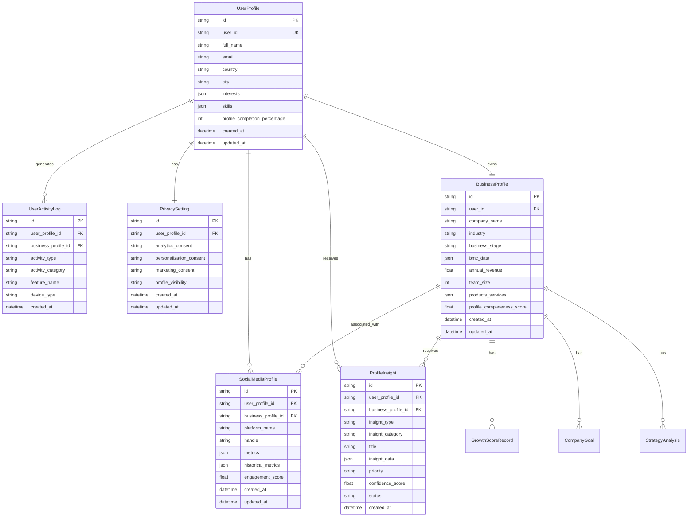
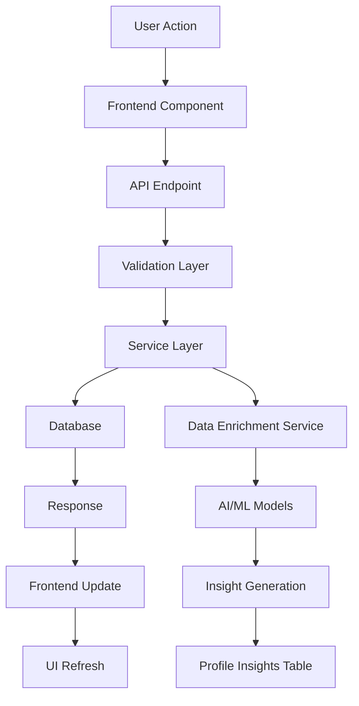
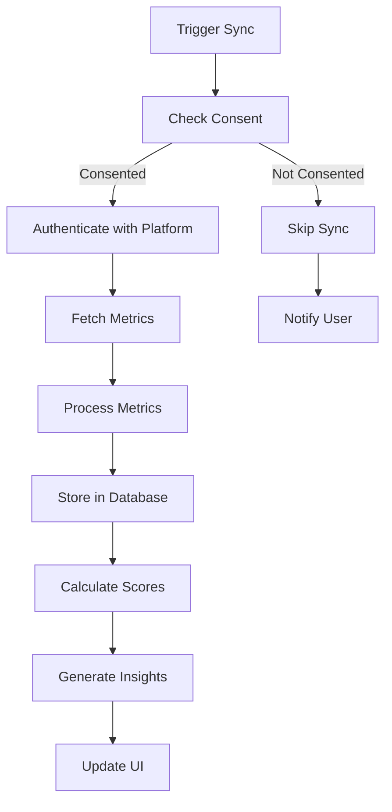
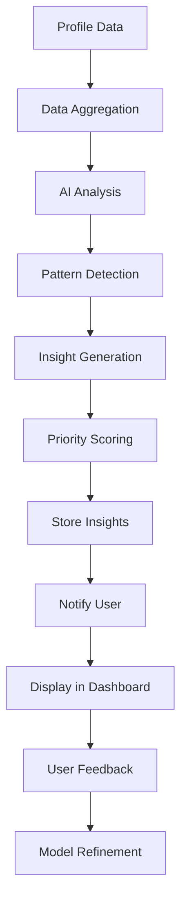

# Enhanced Data Profiling Architecture for SME Toolkit Dashboard

## Executive Summary

This document outlines the comprehensive architecture for implementing enhanced user and business profiling capabilities in the SME Toolkit dashboard. The system will provide deep insights into user demographics, business characteristics, social media presence, and engagement patterns while maintaining robust privacy controls and leveraging AI-powered data enrichment.

## Table of Contents

1. [System Overview](#system-overview)
2. [Database Schema Design](#database-schema-design)
3. [API Architecture](#api-architecture)
4. [Data Profiling Strategy](#data-profiling-strategy)
5. [Frontend Architecture](#frontend-architecture)
6. [Integration Points](#integration-points)
7. [Implementation Recommendations](#implementation-recommendations)
8. [Risk Assessment & Mitigation](#risk-assessment--mitigation)

---

## System Overview

### Current State Analysis

The existing system includes:
- **Backend**: Python FastAPI with SQLAlchemy (SQLite database)
- **Frontend**: React/TypeScript with Vite
- **Core Tables**: `business_profiles`, `growth_scores`, `company_goals`, `strategy_analysis`, etc.
- **Authentication**: JWT-based with basic user credentials
- **Dashboard**: Shows growth scores, goals, and action items

### Enhancement Goals

1. **User Personal Profiles**: Comprehensive demographic, preference, and interest data
2. **Enhanced Business Profiles**: Detailed business characteristics, industry classification, and metrics
3. **Social Media Integration**: Flexible platform support with customizable metrics
4. **Activity Tracking**: Detailed user engagement and feature usage patterns
5. **AI-Powered Insights**: Automated data enrichment and intelligent recommendations
6. **Privacy Controls**: Granular consent management and data protection

### Architecture Principles

- **Scalability**: Design for growth in users and data volume
- **Maintainability**: Clear separation of concerns and modular design
- **Performance**: Optimize for fast data retrieval and minimal latency
- **Privacy-First**: Implement comprehensive data protection from the ground up
- **Extensibility**: Easy to add new profile fields, platforms, and metrics

---

## Database Schema Design

### 1. User Personal Profiles Table

**Table Name**: `user_profiles`

**Purpose**: Store comprehensive personal information about users including demographics, preferences, and interests.

```python
class UserProfile(Base):
    """Comprehensive user personal profile"""
    __tablename__ = "user_profiles"

    # Primary Keys
    id = Column(String, primary_key=True, default=lambda: str(uuid.uuid4()))
    user_id = Column(String, nullable=False, unique=True, index=True)

    # Basic Contact Information
    first_name = Column(String, nullable=True)
    last_name = Column(String, nullable=True)
    full_name = Column(String, nullable=True, index=True)
    email = Column(String, nullable=True, unique=True, index=True)
    phone = Column(String, nullable=True)
    avatar_url = Column(String, nullable=True)

    # Demographics
    date_of_birth = Column(DateTime, nullable=True)
    gender = Column(String, nullable=True)  # male, female, non_binary, prefer_not_to_say, other
    nationality = Column(String, nullable=True)
    country = Column(String, nullable=True, index=True)
    state_province = Column(String, nullable=True)
    city = Column(String, nullable=True)
    postal_code = Column(String, nullable=True)
    timezone = Column(String, nullable=True)
    language = Column(String, nullable=True, default="en")

    # Professional Background
    job_title = Column(String, nullable=True)
    company_role = Column(String, nullable=True)  # owner, ceo, manager, employee, consultant
    years_of_experience = Column(Integer, nullable=True)
    industry_experience = Column(JSON, nullable=True)  # Array of {industry, years}
    education_level = Column(String, nullable=True)  # high_school, bachelor, master, phd, other
    field_of_study = Column(String, nullable=True)
    certifications = Column(JSON, nullable=True)  # Array of certification objects

    # Business Ownership
    owns_business = Column(String, default="false")  # SQLite boolean workaround
    number_of_businesses = Column(Integer, nullable=True)
    primary_business_id = Column(String, ForeignKey("business_profiles.id"), nullable=True)

    # Communication Preferences
    preferred_contact_method = Column(String, nullable=True)  # email, phone, sms, in_app
    email_notifications_enabled = Column(String, default="true")
    sms_notifications_enabled = Column(String, default="false")
    marketing_emails_enabled = Column(String, default="false")
    newsletter_subscription = Column(String, default="false")

    # Interests and Preferences
    interests = Column(JSON, nullable=True)  # Array of interest categories
    skills = Column(JSON, nullable=True)  # Array of skills with proficiency levels
    learning_goals = Column(JSON, nullable=True)  # Array of learning objectives
    business_challenges = Column(JSON, nullable=True)  # Array of current challenges

    # Profile Completion
    profile_completion_percentage = Column(Integer, default=0)
    last_profile_update = Column(DateTime, default=datetime.utcnow)

    # Timestamps
    created_at = Column(DateTime, default=datetime.utcnow)
    updated_at = Column(DateTime, default=datetime.utcnow, onupdate=datetime.utcnow)

    # Relationships
    business_profile = relationship("BusinessProfile", foreign_keys=[primary_business_id])
    social_media_profiles = relationship("SocialMediaProfile", back_populates="user_profile", cascade="all, delete-orphan")
    activity_logs = relationship("UserActivityLog", back_populates="user_profile", cascade="all, delete-orphan")
    privacy_settings = relationship("PrivacySetting", back_populates="user_profile", cascade="all, delete-orphan")
    profile_insights = relationship("ProfileInsight", back_populates="user_profile", cascade="all, delete-orphan")

    __table_args__ = (
        Index('idx_user_email', 'email'),
        Index('idx_user_location', 'country', 'city'),
    )
```

### 2. Enhanced Business Profiles Table

**Table Name**: `business_profiles` (Enhanced)

**Purpose**: Extend existing business profile with detailed business characteristics, metrics, and classification.

**New Fields to Add**:

```python
# Add to existing BusinessProfile model:

# Business Classification
business_type = Column(String, nullable=True)  # sole_proprietorship, partnership, llc, corporation
legal_structure = Column(String, nullable=True)
registration_number = Column(String, nullable=True)
tax_id = Column(String, nullable=True)

# Business Details
founding_date = Column(DateTime, nullable=True)
website_url = Column(String, nullable=True)
business_description = Column(Text, nullable=True)
mission_statement = Column(Text, nullable=True)
vision_statement = Column(Text, nullable=True)

# Location Details
business_address = Column(JSON, nullable=True)  # Full address object
headquarters_location = Column(JSON, nullable=True)
operating_locations = Column(JSON, nullable=True)  # Array of locations

# Team and Organization
team_size = Column(Integer, nullable=True)
team_structure = Column(JSON, nullable=True)  # Org chart or departments
key_team_members = Column(JSON, nullable=True)  # Array of key personnel

# Financial Information
annual_revenue = Column(Float, nullable=True)
revenue_currency = Column(String, default="USD")
revenue_range = Column(String, nullable=True)  # <10k, 10k-50k, 50k-100k, 100k-500k, 500k-1M, 1M-5M, 5M+
profit_margin = Column(Float, nullable=True)
funding_stage = Column(String, nullable=True)  # bootstrapped, seed, series_a, series_b, etc.
funding_amount = Column(Float, nullable=True)

# Business Metrics
customer_count = Column(Integer, nullable=True)
active_customers = Column(Integer, nullable=True)
monthly_active_users = Column(Integer, nullable=True)
customer_acquisition_cost = Column(Float, nullable=True)
customer_lifetime_value = Column(Float, nullable=True)
churn_rate = Column(Float, nullable=True)

# Products and Services
products_services = Column(JSON, nullable=True)  # Array of product/service objects
target_market = Column(JSON, nullable=True)  # Market segments
competitive_advantages = Column(JSON, nullable=True)  # Array of advantages

# Technology Stack
tech_stack = Column(JSON, nullable=True)  # Technologies used
software_tools = Column(JSON, nullable=True)  # Business software
integrations = Column(JSON, nullable=True)  # Third-party integrations

# Business Goals and Challenges
short_term_goals = Column(JSON, nullable=True)
long_term_goals = Column(JSON, nullable=True)
current_challenges = Column(JSON, nullable=True)
growth_opportunities = Column(JSON, nullable=True)

# Profile Metadata
profile_completeness_score = Column(Float, default=0)
last_data_refresh = Column(DateTime, nullable=True)
data_quality_score = Column(Float, nullable=True)
```

### 3. Social Media Profiles Table

**Table Name**: `social_media_profiles`

**Purpose**: Store social media platform connections with flexible, customizable metrics.

```python
class SocialMediaProfile(Base):
    """Social media platform profiles with flexible metrics"""
    __tablename__ = "social_media_profiles"

    # Primary Keys
    id = Column(String, primary_key=True, default=lambda: str(uuid.uuid4()))
    user_profile_id = Column(String, ForeignKey("user_profiles.id"), nullable=False, index=True)
    business_profile_id = Column(String, ForeignKey("business_profiles.id"), nullable=True, index=True)

    # Platform Information
    platform_name = Column(String, nullable=False, index=True)  # linkedin, twitter, facebook, instagram, youtube, tiktok, etc.
    platform_display_name = Column(String, nullable=True)  # User-friendly name
    platform_icon = Column(String, nullable=True)  # Icon URL or emoji

    # Account Details
    handle = Column(String, nullable=True, index=True)
    profile_url = Column(String, nullable=True)
    account_id = Column(String, nullable=True)  # Platform-specific ID
    account_type = Column(String, nullable=True)  # personal, business, creator, etc.
    is_verified = Column(String, default="false")
    is_primary = Column(String, default="false")

    # Connection Status
    is_connected = Column(String, default="false")
    connection_date = Column(DateTime, nullable=True)
    last_sync_date = Column(DateTime, nullable=True)
    sync_status = Column(String, default="not_synced")  # not_synced, syncing, synced, error
    sync_error_message = Column(Text, nullable=True)

    # Flexible Metrics (JSON for platform-specific data)
    metrics = Column(JSON, nullable=True)  # Platform-specific metrics
    # Example structure:
    # {
    #   "followers": 10000,
    #   "following": 500,
    #   "posts": 250,
    #   "engagement_rate": 3.5,
    #   "avg_likes": 350,
    #   "avg_comments": 45,
    #   "avg_shares": 20,
    #   "reach": 50000,
    #   "impressions": 100000,
    #   "profile_views": 5000,
    #   "clicks": 2000,
    #   "mentions": 150,
    #   "hashtags": ["#business", "#growth"],
    #   "last_post_date": "2024-01-15",
    #   "posting_frequency": "daily",
    #   "best_posting_time": "09:00",
    #   "top_performing_content": ["video", "carousel"],
    #   "audience_demographics": {
    #     "age": {"18-24": 20, "25-34": 40, "35-44": 30, "45+": 10},
    #     "gender": {"male": 45, "female": 55},
    #     "location": {"US": 60, "UK": 20, "other": 20}
    #   }
    # }

    # Historical Metrics (for trend analysis)
    historical_metrics = Column(JSON, nullable=True)  # Array of {date, metrics}

    # Content Strategy
    content_categories = Column(JSON, nullable=True)  # Types of content posted
    posting_schedule = Column(JSON, nullable=True)  # Scheduled posts
    content_calendar = Column(JSON, nullable=True)  # Content planning

    # Integration Settings
    auto_sync_enabled = Column(String, default="false")
    sync_frequency = Column(String, nullable=True)  # hourly, daily, weekly
    sync_settings = Column(JSON, nullable=True)  # Platform-specific sync settings

    # Analytics and Insights
    engagement_score = Column(Float, nullable=True)  # Calculated engagement score
    influence_score = Column(Float, nullable=True)  # Calculated influence score
    growth_rate = Column(Float, nullable=True)  # Follower growth rate
    performance_rating = Column(String, nullable=True)  # excellent, good, average, poor

    # Timestamps
    created_at = Column(DateTime, default=datetime.utcnow)
    updated_at = Column(DateTime, default=datetime.utcnow, onupdate=datetime.utcnow)

    # Relationships
    user_profile = relationship("UserProfile", back_populates="social_media_profiles")
    business_profile = relationship("BusinessProfile")

    __table_args__ = (
        Index('idx_social_platform', 'platform_name', 'handle'),
        Index('idx_social_user', 'user_profile_id', 'platform_name'),
    )
```

### 4. User Activity Tracking Table

**Table Name**: `user_activity_logs`

**Purpose**: Track detailed user engagement patterns and feature usage.

```python
class UserActivityLog(Base):
    """Detailed user activity tracking"""
    __tablename__ = "user_activity_logs"

    # Primary Keys
    id = Column(String, primary_key=True, default=lambda: str(uuid.uuid4()))
    user_profile_id = Column(String, ForeignKey("user_profiles.id"), nullable=False, index=True)
    business_profile_id = Column(String, ForeignKey("business_profiles.id"), nullable=True, index=True)

    # Activity Details
    activity_type = Column(String, nullable=False, index=True)  # login, logout, page_view, feature_use, data_update, etc.
    activity_category = Column(String, nullable=True, index=True)  # dashboard, bmc, strategy, leads, etc.
    feature_name = Column(String, nullable=True)  # Specific feature used
    action = Column(String, nullable=True)  # Specific action performed

    # Context Information
    page_url = Column(String, nullable=True)
    referrer_url = Column(String, nullable=True)
    session_id = Column(String, nullable=True, index=True)

    # Device and Browser Information
    device_type = Column(String, nullable=True)  # desktop, mobile, tablet
    browser = Column(String, nullable=True)
    browser_version = Column(String, nullable=True)
    os = Column(String, nullable=True)
    os_version = Column(String, nullable=True)
    screen_resolution = Column(String, nullable=True)

    # Location Information
    ip_address = Column(String, nullable=True)
    country = Column(String, nullable=True)
    city = Column(String, nullable=True)

    # Performance Metrics
    page_load_time = Column(Float, nullable=True)  # in milliseconds
    interaction_time = Column(Float, nullable=True)  # time spent on page/feature

    # Additional Data
    metadata = Column(JSON, nullable=True)  # Flexible additional data
    error_details = Column(Text, nullable=True)  # If activity resulted in error

    # Timestamps
    created_at = Column(DateTime, default=datetime.utcnow, index=True)

    # Relationships
    user_profile = relationship("UserProfile", back_populates="activity_logs")

    __table_args__ = (
        Index('idx_activity_user_date', 'user_profile_id', 'created_at'),
        Index('idx_activity_type_date', 'activity_type', 'created_at'),
    )
```

### 5. Privacy and Consent Management Table

**Table Name**: `privacy_settings`

**Purpose**: Manage user privacy preferences and consent for data collection and usage.

```python
class PrivacySetting(Base):
    """Privacy and consent management"""
    __tablename__ = "privacy_settings"

    # Primary Keys
    id = Column(String, primary_key=True, default=lambda: str(uuid.uuid4()))
    user_profile_id = Column(String, ForeignKey("user_profiles.id"), nullable=False, unique=True, index=True)

    # Data Collection Consent
    analytics_consent = Column(String, default="true")  # Allow analytics tracking
    personalization_consent = Column(String, default="true")  # Allow personalized recommendations
    marketing_consent = Column(String, default="false")  # Allow marketing communications
    third_party_sharing_consent = Column(String, default="false")  # Allow sharing with third parties
    research_consent = Column(String, default="false")  # Allow use in research/anonymized studies

    # Data Retention Preferences
    data_retention_period = Column(String, default="indefinite")  # 30_days, 90_days, 1_year, indefinite
    auto_delete_inactive_account = Column(String, default="false")
    inactivity_threshold_days = Column(Integer, nullable=True)

    # Profile Visibility
    profile_visibility = Column(String, default="private")  # private, public, limited
    visible_profile_fields = Column(JSON, nullable=True)  # Array of fields to make visible
    hide_sensitive_fields = Column(JSON, nullable=True)  # Array of fields to hide

    # Social Media Privacy
    social_media_visibility = Column(String, default="private")  # private, public, limited
    show_social_media_metrics = Column(String, default="true")
    allow_social_media_sync = Column(String, default="true")

    # Activity Tracking
    activity_tracking_enabled = Column(String, default="true")
    track_page_views = Column(String, default="true")
    track_feature_usage = Column(String, default="true")
    track_time_spent = Column(String, default="true")

    # AI and Personalization
    ai_insights_enabled = Column(String, default="true")
    personalized_recommendations = Column(String, default="true")
    predictive_analytics = Column(String, default="true")

    # Communication Preferences
    email_communication_types = Column(JSON, nullable=True)  # Array of allowed email types
    sms_communication_types = Column(JSON, nullable=True)  # Array of allowed SMS types
    push_notification_types = Column(JSON, nullable=True)  # Array of allowed push types

    # Consent History
    consent_history = Column(JSON, nullable=True)  # Array of consent changes
    last_consent_update = Column(DateTime, default=datetime.utcnow)

    # Data Export and Deletion
    data_export_requested = Column(String, default="false")
    data_export_date = Column(DateTime, nullable=True)
    account_deletion_requested = Column(String, default="false")
    account_deletion_date = Column(DateTime, nullable=True)

    # Timestamps
    created_at = Column(DateTime, default=datetime.utcnow)
    updated_at = Column(DateTime, default=datetime.utcnow, onupdate=datetime.utcnow)

    # Relationships
    user_profile = relationship("UserProfile", back_populates="privacy_settings")
```

### 6. Profile Insights Table

**Table Name**: `profile_insights`

**Purpose**: Store AI-generated insights and recommendations based on profile data.

```python
class ProfileInsight(Base):
    """AI-generated profile insights and recommendations"""
    __tablename__ = "profile_insights"

    # Primary Keys
    id = Column(String, primary_key=True, default=lambda: str(uuid.uuid4()))
    user_profile_id = Column(String, ForeignKey("user_profiles.id"), nullable=False, index=True)
    business_profile_id = Column(String, ForeignKey("business_profiles.id"), nullable=True, index=True)

    # Insight Details
    insight_type = Column(String, nullable=False, index=True)  # growth_opportunity, risk_alert, recommendation, trend, pattern
    insight_category = Column(String, nullable=True)  # business, social_media, engagement, financial, operational
    title = Column(String, nullable=False)
    description = Column(Text, nullable=True)

    # Insight Content
    insight_data = Column(JSON, nullable=False)  # Detailed insight data
    # Example structure:
    # {
    #   "summary": "Your LinkedIn engagement rate is above industry average",
    #   "metrics": {
    #     "your_rate": 4.5,
    #     "industry_average": 3.2,
    #     "top_quartile": 5.0
    #   },
    #   "factors": ["consistent posting", "engaging content", "active community"],
    #   "recommendations": [
    #     "Maintain current posting frequency",
    #     "Expand to video content",
    #     "Collaborate with industry leaders"
    #   ],
    #   "potential_impact": "high",
    #   "confidence_score": 0.85
    # }

    # Priority and Impact
    priority = Column(String, nullable=True)  # high, medium, low
    impact_level = Column(String, nullable=True)  # high, medium, low
    confidence_score = Column(Float, nullable=True)  # 0-1

    # Actionability
    is_actionable = Column(String, default="true")
    action_items = Column(JSON, nullable=True)  # Array of actionable steps
    estimated_effort = Column(String, nullable=True)  # low, medium, high
    estimated_timeframe = Column(String, nullable=True)  # immediate, short_term, long_term

    # Status
    status = Column(String, default="new")  # new, viewed, acknowledged, in_progress, completed, dismissed
    user_feedback = Column(String, nullable=True)  # helpful, not_helpful, neutral
    user_notes = Column(Text, nullable=True)

    # Related Insights
    related_insight_ids = Column(JSON, nullable=True)  # Array of related insight IDs
    parent_insight_id = Column(String, nullable=True)  # For grouped insights

    # AI Metadata
    ai_model_version = Column(String, nullable=True)
    generated_at = Column(DateTime, default=datetime.utcnow)
    last_updated = Column(DateTime, default=datetime.utcnow, onupdate=datetime.utcnow)
    expires_at = Column(DateTime, nullable=True)  # Insight expiration date

    # Timestamps
    created_at = Column(DateTime, default=datetime.utcnow)

    # Relationships
    user_profile = relationship("UserProfile", back_populates="profile_insights")

    __table_args__ = (
        Index('idx_insight_type_status', 'insight_type', 'status'),
        Index('idx_insight_priority', 'priority', 'created_at'),
    )
```

### Entity Relationship Diagram



---

## API Architecture

### API Endpoint Design

#### 1. User Profile Endpoints

**Base Path**: `/api/v1/user-profiles`

| Method | Endpoint | Description | Auth Required |
|---------|-----------|-------------|---------------|
| GET | `/` | Get current user profile | Yes |
| GET | `/{profile_id}` | Get specific user profile | Yes |
| POST | `/` | Create new user profile | Yes |
| PUT | `/{profile_id}` | Update user profile | Yes |
| PATCH | `/{profile_id}` | Partial update user profile | Yes |
| DELETE | `/{profile_id}` | Delete user profile | Yes |
| GET | `/{profile_id}/completion` | Get profile completion status | Yes |
| POST | `/{profile_id}/export` | Export profile data | Yes |

**Request/Response Schemas**:

```python
# Create/Update User Profile
class UserProfileCreate(BaseModel):
    first_name: Optional[str] = None
    last_name: Optional[str] = None
    email: Optional[str] = None
    phone: Optional[str] = None
    date_of_birth: Optional[datetime] = None
    gender: Optional[str] = None
    country: Optional[str] = None
    city: Optional[str] = None
    job_title: Optional[str] = None
    years_of_experience: Optional[int] = None
    education_level: Optional[str] = None
    interests: Optional[List[str]] = None
    skills: Optional[List[Dict[str, Any]]] = None
    learning_goals: Optional[List[str]] = None

class UserProfileResponse(BaseModel):
    id: str
    user_id: str
    full_name: Optional[str]
    email: Optional[str]
    country: Optional[str]
    city: Optional[str]
    job_title: Optional[str]
    profile_completion_percentage: int
    created_at: datetime
    updated_at: datetime

class ProfileCompletionResponse(BaseModel):
    profile_id: str
    completion_percentage: int
    missing_fields: List[str]
    recommended_fields: List[str]
    completion_tips: List[str]
```

#### 2. Business Profile Endpoints

**Base Path**: `/api/v1/business-profiles`

| Method | Endpoint | Description | Auth Required |
|---------|-----------|-------------|---------------|
| GET | `/` | Get current business profile | Yes |
| GET | `/{profile_id}` | Get specific business profile | Yes |
| POST | `/` | Create new business profile | Yes |
| PUT | `/{profile_id}` | Update business profile | Yes |
| PATCH | `/{profile_id}` | Partial update business profile | Yes |
| DELETE | `/{profile_id}` | Delete business profile | Yes |
| GET | `/{profile_id}/enrich` | Trigger data enrichment | Yes |
| GET | `/{profile_id}/completeness` | Get profile completeness score | Yes |
| POST | `/{profile_id}/classify` | Classify business stage/industry | Yes |

**Request/Response Schemas**:

```python
class BusinessProfileCreate(BaseModel):
    company_name: str
    industry: Optional[str] = None
    business_stage: Optional[str] = None
    business_type: Optional[str] = None
    founding_date: Optional[datetime] = None
    website_url: Optional[str] = None
    business_description: Optional[str] = None
    team_size: Optional[int] = None
    annual_revenue: Optional[float] = None
    products_services: Optional[List[Dict[str, Any]]] = None
    target_market: Optional[List[str]] = None

class BusinessProfileResponse(BaseModel):
    id: str
    user_id: str
    company_name: str
    industry: Optional[str]
    business_stage: Optional[str]
    profile_completeness_score: float
    created_at: datetime
    updated_at: datetime

class BusinessEnrichmentResponse(BaseModel):
    profile_id: str
    enriched_fields: Dict[str, Any]
    inferred_business_stage: Optional[str]
    inferred_industry: Optional[str]
    confidence_scores: Dict[str, float]
    recommendations: List[str]
```

#### 3. Social Media Profile Endpoints

**Base Path**: `/api/v1/social-media`

| Method | Endpoint | Description | Auth Required |
|---------|-----------|-------------|---------------|
| GET | `/` | Get all social media profiles | Yes |
| GET | `/{profile_id}` | Get specific social media profile | Yes |
| POST | `/` | Add social media profile | Yes |
| PUT | `/{profile_id}` | Update social media profile | Yes |
| DELETE | `/{profile_id}` | Remove social media profile | Yes |
| POST | `/{profile_id}/sync` | Trigger manual sync | Yes |
| GET | `/{profile_id}/metrics` | Get current metrics | Yes |
| GET | `/{profile_id}/metrics/history` | Get historical metrics | Yes |
| GET | `/{profile_id}/analytics` | Get analytics and insights | Yes |
| POST | `/{profile_id}/connect` | Connect to platform API | Yes |
| POST | `/{profile_id}/disconnect` | Disconnect from platform | Yes |

**Request/Response Schemas**:

```python
class SocialMediaProfileCreate(BaseModel):
    platform_name: str
    handle: str
    profile_url: Optional[str] = None
    account_type: Optional[str] = None
    is_primary: bool = False
    auto_sync_enabled: bool = False
    sync_frequency: Optional[str] = None

class SocialMediaProfileResponse(BaseModel):
    id: str
    user_profile_id: str
    platform_name: str
    handle: str
    is_connected: bool
    metrics: Optional[Dict[str, Any]]
    engagement_score: Optional[float]
    last_sync_date: Optional[datetime]
    created_at: datetime
    updated_at: datetime

class SocialMediaAnalyticsResponse(BaseModel):
    profile_id: str
    platform_name: str
    current_metrics: Dict[str, Any]
    historical_trends: Dict[str, List[Dict[str, Any]]]
    performance_rating: str
    insights: List[str]
    recommendations: List[str]
    benchmark_comparison: Optional[Dict[str, Any]]
```

#### 4. Profile Analytics Endpoints

**Base Path**: `/api/v1/profile-analytics`

| Method | Endpoint | Description | Auth Required |
|---------|-----------|-------------|---------------|
| GET | `/overview` | Get profile analytics overview | Yes |
| GET | `/activity` | Get user activity analytics | Yes |
| GET | `/engagement` | Get engagement patterns | Yes |
| GET | `/insights` | Get AI-generated insights | Yes |
| GET | `/trends` | Get trend analysis | Yes |
| GET | `/benchmarks` | Get benchmark comparisons | Yes |
| POST | `/insights/{insight_id}/feedback` | Provide feedback on insight | Yes |
| POST | `/insights/{insight_id}/dismiss` | Dismiss an insight | Yes |

**Request/Response Schemas**:

```python
class ProfileAnalyticsOverview(BaseModel):
    user_profile_id: str
    business_profile_id: Optional[str]
    profile_completion: int
    activity_summary: Dict[str, Any]
    social_media_summary: Dict[str, Any]
    engagement_metrics: Dict[str, Any]
    key_insights: List[str]
    recommendations: List[str]

class UserActivityAnalytics(BaseModel):
    user_profile_id: str
    time_range: str
    total_sessions: int
    total_time_spent: float
    most_used_features: List[Dict[str, Any]]
    activity_by_category: Dict[str, int]
    peak_activity_times: List[Dict[str, Any]]
    engagement_trend: List[Dict[str, Any]]

class ProfileInsightsResponse(BaseModel):
    insights: List[Dict[str, Any]]
    total: int
    unread_count: int
    high_priority_count: int
    categories: Dict[str, int]
```

#### 5. Privacy Settings Endpoints

**Base Path**: `/api/v1/privacy`

| Method | Endpoint | Description | Auth Required |
|---------|-----------|-------------|---------------|
| GET | `/` | Get current privacy settings | Yes |
| PUT | `/` | Update privacy settings | Yes |
| GET | `/consent` | Get consent status | Yes |
| POST | `/consent` | Update consent preferences | Yes |
| POST | `/export-data` | Request data export | Yes |
| GET | `/export-data/{request_id}` | Get export status | Yes |
| POST | `/delete-account` | Request account deletion | Yes |
| GET | `/audit-log` | Get privacy audit log | Yes |

**Request/Response Schemas**:

```python
class PrivacySettingsUpdate(BaseModel):
    analytics_consent: Optional[bool] = None
    personalization_consent: Optional[bool] = None
    marketing_consent: Optional[bool] = None
    profile_visibility: Optional[str] = None
    activity_tracking_enabled: Optional[bool] = None
    ai_insights_enabled: Optional[bool] = None

class PrivacySettingsResponse(BaseModel):
    user_profile_id: str
    analytics_consent: bool
    personalization_consent: bool
    marketing_consent: bool
    profile_visibility: str
    activity_tracking_enabled: bool
    ai_insights_enabled: bool
    last_consent_update: datetime

class DataExportRequest(BaseModel):
    include_activity_logs: bool = True
    include_social_media: bool = True
    format: str = "json"  # json, csv

class DataExportResponse(BaseModel):
    request_id: str
    status: str
    download_url: Optional[str]
    expires_at: Optional[datetime]
```

### API Authentication and Authorization

**Current System**: JWT-based authentication with basic user credentials

**Enhanced Security**:
- Role-based access control (RBAC)
- API rate limiting
- Request validation and sanitization
- Audit logging for all profile data access
- Data encryption at rest and in transit

**Authorization Levels**:
1. **Owner**: Full access to own profile data
2. **Admin**: Full access to all profiles (for support)
3. **System**: Internal system access for data processing

---

## Data Profiling Strategy

### 1. Data Collection Mechanisms

#### Automated Data Collection

**User Activity Tracking**:
- Page views and navigation patterns
- Feature usage frequency and duration
- Form completion and abandonment
- Search queries and filters used
- Dashboard interactions and clicks

**Social Media Integration**:
- OAuth-based API connections
- Scheduled metric synchronization
- Real-time webhook updates (when available)
- Historical data backfilling

**Business Data Enrichment**:
- Industry classification APIs
- Company information lookup services
- Geographic data enrichment
- Market data integration

#### Manual Data Collection

**Profile Completion Forms**:
- Progressive disclosure (show fields as needed)
- Smart defaults and suggestions
- Validation and real-time feedback
- Save-as-you-go functionality

**Onboarding Flow**:
- Guided setup wizard
- Step-by-step profile building
- Contextual help and examples
- Progress tracking

### 2. Data Enrichment Strategy

#### AI-Powered Enrichment

**Business Stage Inference**:
```python
def infer_business_stage(revenue, team_size, years_in_business):
    """
    Infer business stage based on multiple factors
    Returns: stage, confidence_score
    """
    factors = {
        'revenue': normalize_revenue(revenue),
        'team_size': normalize_team_size(team_size),
        'years': normalize_years(years_in_business)
    }

    # Use ML model or rule-based logic
    stage = classify_stage(factors)
    confidence = calculate_confidence(factors)

    return stage, confidence
```

**Industry Classification**:
- Natural language processing on business description
- Product/service categorization
- Competitor analysis
- Market segment identification

**Social Media Insights**:
- Content analysis and sentiment
- Audience demographic inference
- Best posting time optimization
- Content performance prediction

#### External Data Sources

**Business Intelligence APIs**:
- Company information services (e.g., Crunchbase, LinkedIn)
- Industry benchmarking data
- Market research databases
- Geographic and demographic data

**Social Media APIs**:
- Platform-specific analytics APIs
- Engagement metrics
- Audience insights
- Content performance data

### 3. Data Quality Management

**Validation Rules**:
- Email format validation
- Phone number format validation
- Date range validation
- Numeric range validation
- Enum value validation

**Data Cleaning**:
- Duplicate detection and merging
- Standardization of formats
- Missing value handling
- Outlier detection and handling

**Quality Scoring**:
```python
def calculate_data_quality_score(profile_data):
    """
    Calculate data quality score (0-100)
    Factors: completeness, accuracy, consistency, timeliness
    """
    completeness = calculate_completeness(profile_data)
    accuracy = validate_data_accuracy(profile_data)
    consistency = check_data_consistency(profile_data)
    timeliness = assess_data_timeliness(profile_data)

    weights = {
        'completeness': 0.4,
        'accuracy': 0.3,
        'consistency': 0.2,
        'timeliness': 0.1
    }

    quality_score = (
        completeness * weights['completeness'] +
        accuracy * weights['accuracy'] +
        consistency * weights['consistency'] +
        timeliness * weights['timeliness']
    )

    return quality_score
```

### 4. Privacy and Data Protection

#### Consent Management

**Granular Consent Options**:
- Analytics tracking
- Personalization
- Marketing communications
- Third-party data sharing
- Research participation

**Consent Recording**:
```python
class ConsentRecord(BaseModel):
    consent_type: str
    granted: bool
    timestamp: datetime
    ip_address: Optional[str]
    user_agent: Optional[str]
    consent_version: str
```

#### Data Anonymization

**Techniques**:
- Hashing of sensitive identifiers
- Generalization of geographic data
- Suppression of rare combinations
- Differential privacy for analytics

**Anonymization Levels**:
1. **Identified**: Full data with identifiers
2. **Pseudonymized**: Replaced identifiers with tokens
3. **Anonymized**: Removed or generalized identifiers
4. **Aggregated**: Statistical summaries only

#### Data Retention

**Retention Policies**:
- Activity logs: 90 days (configurable)
- Social media metrics: 1 year
- Profile data: Until account deletion
- Analytics data: 2 years (anonymized after 90 days)

**Automated Cleanup**:
- Scheduled deletion jobs
- Soft delete with grace period
- Backup and recovery procedures

---

## Frontend Architecture

### 1. Dashboard Layout Design

#### Main Dashboard Structure

```
┌─────────────────────────────────────────────────────────────┐
│  Header (User Profile, Notifications, Settings)              │
├─────────────────────────────────────────────────────────────┤
│  ┌─────────────┐  ┌─────────────────────────────────────┐  │
│  │             │  │  User Profile Overview Card          │  │
│  │   Sidebar   │  │  - Avatar, Name, Role               │  │
│  │   - Nav     │  │  - Profile Completion Progress      │  │
│  │   - Tools   │  │  - Quick Stats                       │  │
│  │             │  │  - Action Buttons                    │  │
│  │             │  └─────────────────────────────────────┘  │
│  │             │                                           │
│  │             │  ┌─────────────────────────────────────┐  │
│  │             │  │  Business Information Panel         │  │
│  │             │  │  - Company Details                 │  │
│  │             │  │  - Industry & Stage                │  │
│  │             │  │  - Team Size & Revenue             │  │
│  │             │  │  - Key Metrics                      │  │
│  │             │  └─────────────────────────────────────┘  │
│  │             │                                           │
│  │             │  ┌─────────────────────────────────────┐  │
│  │             │  │  Social Media Integration            │  │
│  │             │  │  - Connected Platforms              │  │
│  │             │  │  - Metrics Overview                 │  │
│  │             │  │  - Engagement Scores                │  │
│  │             │  │  - Add Platform Button              │  │
│  │             │  └─────────────────────────────────────┘  │
│  │             │                                           │
│  │             │  ┌─────────────────────────────────────┐  │
│  │             │  │  Data Profiling Insights            │  │
│  │             │  │  - AI Recommendations               │  │
│  │             │  │  - Growth Opportunities             │  │
│  │             │  │  - Risk Alerts                      │  │
│  │             │  │  - Trend Analysis                   │  │
│  │             │  └─────────────────────────────────────┘  │
│  │             │                                           │
│  │             │  ┌─────────────────────────────────────┐  │
│  │             │  │  Activity Timeline                  │  │
│  │             │  │  - Recent Activities                │  │
│  │             │  │  - Feature Usage                    │  │
│  │             │  │  - Engagement Patterns              │  │
│  │             │  └─────────────────────────────────────┘  │
│  └─────────────┘                                           │
└─────────────────────────────────────────────────────────────┘
```

### 2. Component Hierarchy

```
DashboardLayout
├── Header
│   ├── UserProfileMenu
│   ├── NotificationBell
│   └── SettingsButton
├── Sidebar
│   ├── NavigationMenu
│   └── QuickActions
└── MainContent
    ├── UserProfileOverview
    │   ├── ProfileAvatar
    │   ├── ProfileInfo
    │   ├── CompletionProgressBar
    │   └── QuickStats
    ├── BusinessInfoPanel
    │   ├── CompanyDetails
    │   ├── IndustryBadge
    │   ├── BusinessStageBadge
    │   ├── MetricsGrid
    │   └── EditProfileButton
    ├── SocialMediaSection
    │   ├── PlatformList
    │   ├── PlatformCard
    │   │   ├── PlatformIcon
    │   │   ├── MetricsSummary
    │   │   ├── EngagementScore
    │   │   └── SyncButton
    │   └── AddPlatformButton
    ├── ProfileInsights
    │   ├── InsightsList
    │   ├── InsightCard
    │   │   ├── InsightIcon
    │   │   ├── InsightTitle
    │   │   ├── InsightDescription
    │   │   ├── PriorityBadge
    │   │   └── ActionButtons
    │   └── LoadMoreButton
    └── ActivityTimeline
        ├── ActivityList
        ├── ActivityItem
        │   ├── ActivityIcon
        │   ├── ActivityDescription
        │   ├── ActivityTimestamp
        │   └── ActivityDetails
        └── FilterControls
```

### 3. State Management Approach

**Context-Based State Management**:

```typescript
// UserProfileContext.tsx
interface UserProfileContextType {
  userProfile: UserProfile | null;
  businessProfile: BusinessProfile | null;
  socialMediaProfiles: SocialMediaProfile[];
  insights: ProfileInsight[];
  loading: boolean;
  error: string | null;

  // Actions
  loadUserProfile: () => Promise<void>;
  updateProfile: (data: Partial<UserProfile>) => Promise<void>;
  addSocialMedia: (profile: SocialMediaProfileCreate) => Promise<void>;
  syncSocialMedia: (profileId: string) => Promise<void>;
  dismissInsight: (insightId: string) => Promise<void>;
  refreshData: () => Promise<void>;
}

const UserProfileContext = createContext<UserProfileContextType | undefined>(undefined);
```

**State Structure**:

```typescript
interface DashboardState {
  // User Profile
  userProfile: {
    data: UserProfile | null;
    loading: boolean;
    error: string | null;
    completion: number;
  };

  // Business Profile
  businessProfile: {
    data: BusinessProfile | null;
    loading: boolean;
    error: string | null;
    completeness: number;
  };

  // Social Media
  socialMedia: {
    profiles: SocialMediaProfile[];
    loading: boolean;
    syncing: Set<string>;
    error: string | null;
  };

  // Insights
  insights: {
    data: ProfileInsight[];
    loading: boolean;
    unreadCount: number;
    filters: InsightFilters;
  };

  // Activity
  activity: {
    logs: UserActivityLog[];
    loading: boolean;
    filters: ActivityFilters;
  };

  // UI State
  ui: {
    activeTab: string;
    editingSection: string | null;
    showNotifications: boolean;
    sidebarCollapsed: boolean;
  };
}
```

### 4. Responsive Design Strategy

**Breakpoints**:
- Mobile: < 640px
- Tablet: 640px - 1024px
- Desktop: > 1024px

**Mobile Adaptations**:
- Collapsible sidebar with hamburger menu
- Stacked card layout
- Touch-friendly controls
- Simplified navigation

**Tablet Adaptations**:
- Two-column layout
- Optimized card sizes
- Swipe gestures for navigation

**Desktop Features**:
- Three-column layout
- Hover interactions
- Keyboard shortcuts
- Drag-and-drop functionality

### 5. Component Specifications

#### UserProfileOverview Component

**Props**:
```typescript
interface UserProfileOverviewProps {
  userProfile: UserProfile;
  onEdit: () => void;
  onViewDetails: () => void;
}
```

**Features**:
- Display avatar with upload option
- Show name, role, and location
- Profile completion progress bar
- Quick stats (connections, activity, insights)
- Action buttons (Edit Profile, View Details)

#### BusinessInfoPanel Component

**Props**:
```typescript
interface BusinessInfoPanelProps {
  businessProfile: BusinessProfile;
  onEdit: () => void;
  onEnrich: () => void;
}
```

**Features**:
- Company name and logo
- Industry and stage badges
- Key metrics (team size, revenue, customers)
- Products/services summary
- Edit and enrich buttons

#### SocialMediaSection Component

**Props**:
```typescript
interface SocialMediaSectionProps {
  profiles: SocialMediaProfile[];
  onAddPlatform: () => void;
  onSync: (profileId: string) => void;
  onEdit: (profileId: string) => void;
  onRemove: (profileId: string) => void;
}
```

**Features**:
- Grid of connected platforms
- Each platform shows:
  - Platform icon and name
  - Handle and link
  - Key metrics (followers, engagement)
  - Engagement score
  - Sync status
- Add platform button
- Sync all button

#### ProfileInsights Component

**Props**:
```typescript
interface ProfileInsightsProps {
  insights: ProfileInsight[];
  onDismiss: (insightId: string) => void;
  onFeedback: (insightId: string, feedback: string) => void;
  onLoadMore: () => void;
}
```

**Features**:
- Filter by type and priority
- Sort by date or priority
- Insight cards with:
  - Type icon and category
  - Title and description
  - Priority badge
  - Confidence score
  - Action buttons
- Load more functionality

---

## Integration Points

### 1. Integration with Existing Features

#### Growth Scoring Integration

**Data Flow**:
```
UserProfile/BusinessProfile → GrowthScoreService → Enhanced Scoring
```

**Enhancements**:
- Use social media engagement in growth score calculation
- Incorporate user activity patterns into execution capability
- Leverage business completeness in market readiness
- Use profile insights for improvement recommendations

**API Integration**:
```python
# Enhanced growth score calculation
async def calculate_enhanced_growth_score(business_profile_id: str):
    # Get profile data
    user_profile = await get_user_profile(business_profile_id)
    social_media = await get_social_media_profiles(business_profile_id)
    activity_data = await get_activity_analytics(business_profile_id)

    # Calculate enhanced components
    bmc_quality = await calculate_bmc_quality(business_profile_id)
    strategy_alignment = await calculate_strategy_alignment(business_profile_id)
    market_readiness = await calculate_market_readiness(business_profile_id, social_media)
    execution_capability = await calculate_execution_capability(business_profile_id, activity_data)

    # Combine with weights
    overall_score = (
        bmc_quality * 0.25 +
        strategy_alignment * 0.25 +
        market_readiness * 0.30 +
        execution_capability * 0.20
    )

    return overall_score
```

#### Strategy Advisor Integration

**Data Flow**:
```
UserProfile/BusinessProfile → StrategyAdvisor → Personalized Recommendations
```

**Enhancements**:
- Personalize strategy recommendations based on user profile
- Consider user skills and experience in strategy suggestions
- Use social media presence in marketing strategy
- Leverage business challenges in goal setting

**API Integration**:
```python
# Personalized strategy analysis
async def generate_personalized_strategy(business_profile_id: str):
    # Get profile context
    user_profile = await get_user_profile(business_profile_id)
    business_profile = await get_business_profile(business_profile_id)
    insights = await get_profile_insights(business_profile_id)

    # Generate personalized strategy
    strategy = await strategy_agent.generate(
        business_context=business_profile,
        user_context=user_profile,
        insights=insights
    )

    return strategy
```

#### Lead Manager Integration

**Data Flow**:
```
UserProfile/BusinessProfile → LeadManager → Enhanced Lead Scoring
```

**Enhancements**:
- Use social media presence in lead scoring
- Incorporate user preferences in lead prioritization
- Leverage business stage in lead qualification
- Use activity patterns in follow-up timing

#### Analytics Integration

**Data Flow**:
```
UserProfile/BusinessProfile → Analytics → Enhanced Metrics
```

**Enhancements**:
- Track profile completion over time
- Monitor social media growth trends
- Analyze user engagement patterns
- Correlate profile data with business outcomes

### 2. Data Flow Diagrams

#### Profile Data Collection Flow



#### Social Media Sync Flow



#### Insight Generation Flow



### 3. Caching Strategy

#### Cache Layers

**1. Frontend Cache**:
- React Query for API responses
- LocalStorage for user preferences
- SessionStorage for temporary data

**2. Backend Cache**:
- Redis for frequently accessed profile data
- In-memory cache for computed insights
- CDN for static assets

**3. Database Cache**:
- Query result caching
- Materialized views for aggregations
- Indexed views for common queries

#### Cache Invalidation Strategy

**Time-Based**:
- User profile: 5 minutes
- Business profile: 10 minutes
- Social media metrics: 15 minutes
- Insights: 30 minutes

**Event-Based**:
- Invalidate on profile update
- Invalidate on social media sync
- Invalidate on new insight generation

**Manual**:
- User-triggered refresh
- Admin-triggered cache clear

#### Cache Implementation

```python
# Redis caching decorator
def cache_result(ttl: int = 300):
    def decorator(func):
        async def wrapper(*args, **kwargs):
            # Generate cache key
            cache_key = f"{func.__name__}:{str(args)}:{str(kwargs)}"

            # Try to get from cache
            cached = await redis.get(cache_key)
            if cached:
                return json.loads(cached)

            # Execute function
            result = await func(*args, **kwargs)

            # Cache result
            await redis.setex(cache_key, ttl, json.dumps(result))

            return result
        return wrapper
    return decorator

# Usage
@cache_result(ttl=300)
async def get_user_profile(user_id: str):
    # Database query
    return profile
```

---

## Implementation Recommendations

### 1. Phased Implementation Approach

#### Phase 1: Foundation (Weeks 1-2)

**Backend**:
- Create new database tables
- Implement basic CRUD endpoints
- Set up authentication and authorization
- Create base service layer

**Frontend**:
- Set up component structure
- Implement basic dashboard layout
- Create profile overview components
- Set up state management

**Deliverables**:
- Database schema deployed
- Basic API endpoints functional
- Dashboard skeleton with profile overview

#### Phase 2: Core Features (Weeks 3-4)

**Backend**:
- Implement social media integration
- Create activity tracking system
- Build data enrichment services
- Implement privacy settings

**Frontend**:
- Build social media components
- Create activity timeline
- Implement profile editing forms
- Add privacy settings UI

**Deliverables**:
- Social media integration working
- Activity tracking functional
- Profile editing complete
- Privacy controls implemented

#### Phase 3: Advanced Features (Weeks 5-6)

**Backend**:
- Implement AI-powered insights
- Build analytics and reporting
- Create benchmark comparison
- Implement advanced caching

**Frontend**:
- Build insights dashboard
- Create analytics visualizations
- Implement benchmark comparisons
- Add advanced filtering and sorting

**Deliverables**:
- AI insights generating
- Analytics dashboard complete
- Benchmark comparisons working
- Performance optimized

#### Phase 4: Integration & Polish (Weeks 7-8)

**Backend**:
- Integrate with existing features
- Optimize performance
- Add comprehensive logging
- Implement monitoring

**Frontend**:
- Integrate with existing dashboard
- Polish UI/UX
- Add responsive design
- Implement error handling

**Deliverables**:
- Full integration complete
- Performance optimized
- UI/UX polished
- Production-ready

### 2. Technology Stack Recommendations

#### Backend Enhancements

**Data Processing**:
- Pandas for data manipulation
- NumPy for numerical computations
- Scikit-learn for ML models

**AI/ML**:
- OpenAI API for natural language processing
- Custom ML models for predictions
- TensorFlow/PyTorch for advanced ML

**Caching**:
- Redis for distributed caching
- Memcached as alternative

**Monitoring**:
- Prometheus for metrics
- Grafana for visualization
- Sentry for error tracking

#### Frontend Enhancements

**Data Visualization**:
- Recharts for charts and graphs
- D3.js for advanced visualizations
- React-Vis for scientific plotting

**State Management**:
- React Query for server state
- Zustand for client state
- React Context for global state

**UI Components**:
- Tailwind CSS for styling
- Headless UI for accessible components
- Framer Motion for animations

**Performance**:
- React.memo for component memoization
- useMemo/useCallback for optimization
- Virtual scrolling for large lists

### 3. Best Practices

#### Database Design

**Normalization**:
- Normalize to 3NF for core tables
- Denormalize for frequently accessed data
- Use JSON fields for flexible data

**Indexing**:
- Index foreign keys
- Index frequently queried columns
- Create composite indexes for common query patterns

**Constraints**:
- Use NOT NULL for required fields
- Use UNIQUE for unique identifiers
- Use CHECK for data validation

#### API Design

**RESTful Principles**:
- Use appropriate HTTP methods
- Use resource-based URLs
- Implement proper status codes
- Use pagination for large datasets

**Error Handling**:
- Use consistent error response format
- Include helpful error messages
- Log errors for debugging
- Implement retry logic for transient errors

**Documentation**:
- Use OpenAPI/Swagger for API docs
- Include request/response examples
- Document authentication requirements
- Provide usage examples

#### Frontend Development

**Component Design**:
- Keep components small and focused
- Use composition over inheritance
- Implement proper prop types
- Use TypeScript for type safety

**Performance**:
- Implement code splitting
- Use lazy loading for routes
- Optimize images and assets
- Implement service worker for caching

**Accessibility**:
- Use semantic HTML
- Implement keyboard navigation
- Add ARIA labels
- Test with screen readers

**Testing**:
- Unit tests for components
- Integration tests for API calls
- E2E tests for critical flows
- Visual regression tests

### 4. Security Considerations

#### Data Protection

**Encryption**:
- Encrypt sensitive data at rest
- Use TLS for data in transit
- Implement field-level encryption
- Use secure key management

**Access Control**:
- Implement RBAC
- Use JWT with short expiration
- Implement refresh token rotation
- Log all access attempts

**Input Validation**:
- Validate all user inputs
- Sanitize data before storage
- Use parameterized queries
- Implement rate limiting

#### Privacy Compliance

**GDPR Compliance**:
- Implement right to access
- Implement right to deletion
- Implement data portability
- Maintain consent records

**Data Minimization**:
- Collect only necessary data
- Anonymize data for analytics
- Implement data retention policies
- Regularly review data collection

---

## Risk Assessment & Mitigation

### 1. Technical Risks

#### Risk 1: Performance Degradation

**Description**: Large amounts of profile data and social media metrics could slow down the system.

**Probability**: Medium
**Impact**: High

**Mitigation Strategies**:
- Implement efficient caching strategy
- Use database indexing
- Implement pagination for large datasets
- Optimize database queries
- Use read replicas for scaling

#### Risk 2: Data Quality Issues

**Description**: Inaccurate or incomplete profile data could lead to poor insights.

**Probability**: High
**Impact**: Medium

**Mitigation Strategies**:
- Implement data validation
- Use data quality scoring
- Provide user feedback on data quality
- Implement data enrichment
- Regular data audits

#### Risk 3: Social Media API Limitations

**Description**: Rate limits and API changes from social media platforms could affect functionality.

**Probability**: Medium
**Impact**: High

**Mitigation Strategies**:
- Implement rate limiting
- Use caching to reduce API calls
- Monitor API usage
- Have fallback mechanisms
- Stay updated on API changes

#### Risk 4: AI Model Accuracy

**Description**: AI-generated insights may not always be accurate or relevant.

**Probability**: Medium
**Impact**: Medium

**Mitigation Strategies**:
- Implement confidence scoring
- Allow user feedback on insights
- Continuously train and improve models
- Use ensemble methods
- Provide human review for critical insights

### 2. Security Risks

#### Risk 1: Data Breach

**Description**: Unauthorized access to sensitive user data.

**Probability**: Low
**Impact**: Critical

**Mitigation Strategies**:
- Implement strong authentication
- Use encryption at rest and in transit
- Regular security audits
- Implement intrusion detection
- Have incident response plan

#### Risk 2: Privacy Violations

**Description**: Inadvertent disclosure of user data or violation of privacy preferences.

**Probability**: Medium
**Impact**: High

**Mitigation Strategies**:
- Implement granular consent management
- Regular privacy audits
- Data anonymization for analytics
- Clear privacy policy
- User control over data

#### Risk 3: API Abuse

**Description**: Malicious actors could abuse API endpoints.

**Probability**: Medium
**Impact**: Medium

**Mitigation Strategies**:
- Implement rate limiting
- Use API keys
- Monitor for suspicious activity
- Implement CAPTCHA for sensitive operations
- Use Web Application Firewall

### 3. Operational Risks

#### Risk 1: User Adoption

**Description**: Users may not adopt new profiling features.

**Probability**: Medium
**Impact**: High

**Mitigation Strategies**:
- Provide clear value proposition
- Make onboarding easy
- Show immediate benefits
- Provide incentives for completion
- Gather user feedback

#### Risk 2: Maintenance Overhead

**Description**: Maintaining social media integrations and AI models could be resource-intensive.

**Probability**: High
**Impact**: Medium

**Mitigation Strategies**:
- Design for maintainability
- Use abstraction layers
- Implement monitoring and alerting
- Plan for regular updates
- Document thoroughly

#### Risk 3: Scalability Issues

**Description**: System may not scale with increased user base and data volume.

**Probability**: Medium
**Impact**: High

**Mitigation Strategies**:
- Design for horizontal scaling
- Use load balancing
- Implement database sharding if needed
- Use cloud-native services
- Regular performance testing

### 4. Compliance Risks

#### Risk 1: GDPR Non-Compliance

**Description**: Failure to comply with GDPR requirements.

**Probability**: Low
**Impact**: Critical

**Mitigation Strategies**:
- Conduct privacy impact assessment
- Implement data subject rights
- Maintain consent records
- Regular compliance audits
- Legal review of implementation

#### Risk 2: Platform Terms of Service Violation

**Description**: Violating social media platform terms of service.

**Probability**: Medium
**Impact**: High

**Mitigation Strategies**:
- Review platform terms carefully
- Implement rate limiting
- Respect user privacy settings
- Stay updated on policy changes
- Have legal review

---

## Conclusion

This architecture provides a comprehensive foundation for implementing enhanced data profiling capabilities in the SME Toolkit dashboard. The design balances functionality, performance, security, and user experience while providing clear implementation guidance.

### Key Success Factors

1. **User-Centric Design**: Focus on providing value to users through actionable insights
2. **Privacy-First Approach**: Build trust through transparent data practices
3. **Scalable Architecture**: Design for growth from the start
4. **Iterative Implementation**: Deliver value incrementally through phased approach
5. **Continuous Improvement**: Use feedback and data to refine the system

### Next Steps

1. Review and approve this architecture document
2. Create detailed implementation tasks for each phase
3. Set up development and testing environments
4. Begin Phase 1 implementation
5. Establish monitoring and feedback mechanisms

### Success Metrics

- Profile completion rate > 80%
- User engagement with insights > 60%
- Social media integration adoption > 50%
- System performance: < 2s page load time
- User satisfaction score > 4.5/5

---

## Appendix

### A. Database Migration Scripts

```python
# Migration: Add enhanced profile tables
async def upgrade():
    # Create user_profiles table
    await conn.execute("""
        CREATE TABLE user_profiles (
            id VARCHAR(36) PRIMARY KEY,
            user_id VARCHAR(255) UNIQUE NOT NULL,
            first_name VARCHAR(255),
            last_name VARCHAR(255),
            full_name VARCHAR(255),
            email VARCHAR(255) UNIQUE,
            phone VARCHAR(50),
            country VARCHAR(100),
            city VARCHAR(100),
            job_title VARCHAR(255),
            years_of_experience INTEGER,
            education_level VARCHAR(50),
            interests JSON,
            skills JSON,
            profile_completion_percentage INTEGER DEFAULT 0,
            created_at DATETIME DEFAULT CURRENT_TIMESTAMP,
            updated_at DATETIME DEFAULT CURRENT_TIMESTAMP
        )
    """)

    # Create indexes
    await conn.execute("CREATE INDEX idx_user_email ON user_profiles(email)")
    await conn.execute("CREATE INDEX idx_user_location ON user_profiles(country, city)")

    # Similar for other tables...
```

### B. API Endpoint Examples

```python
# Example: Get user profile with related data
@router.get("/user-profiles/{profile_id}")
async def get_user_profile(
    profile_id: str,
    include_social_media: bool = False,
    include_insights: bool = False,
    db: AsyncSession = Depends(get_db)
):
    profile = await get_user_profile_by_id(db, profile_id)

    response = UserProfileResponse.from_orm(profile)

    if include_social_media:
        response.social_media = await get_social_media_profiles(db, profile_id)

    if include_insights:
        response.insights = await get_profile_insights(db, profile_id)

    return response
```

### C. Frontend Component Example

```typescript
// UserProfileOverview.tsx
const UserProfileOverview: React.FC<UserProfileOverviewProps> = ({
  userProfile,
  onEdit,
  onViewDetails
}) => {
  const { data: insights } = useProfileInsights(userProfile.id);

  return (
    <Card className="p-6">
      <div className="flex items-center space-x-4">
        <Avatar src={userProfile.avatar_url} size="lg" />
        <div className="flex-1">
          <h2 className="text-2xl font-bold">{userProfile.full_name}</h2>
          <p className="text-gray-600">{userProfile.job_title}</p>
          <div className="mt-2">
            <ProgressBar
              value={userProfile.profile_completion_percentage}
              label="Profile Completion"
            />
          </div>
        </div>
        <div className="flex space-x-2">
          <Button onClick={onEdit}>Edit</Button>
          <Button variant="outline" onClick={onViewDetails}>
            View Details
          </Button>
        </div>
      </div>

      {insights && insights.length > 0 && (
        <div className="mt-6">
          <h3 className="font-semibold mb-3">Recent Insights</h3>
          <InsightList insights={insights.slice(0, 3)} />
        </div>
      )}
    </Card>
  );
};
```

---

**Document Version**: 1.0
**Last Updated**: 2025-01-02
**Author**: Architecture Team
**Status**: Ready for Review
