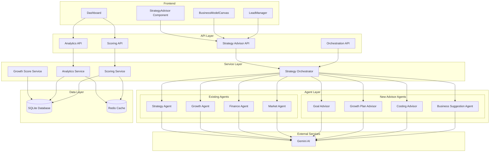
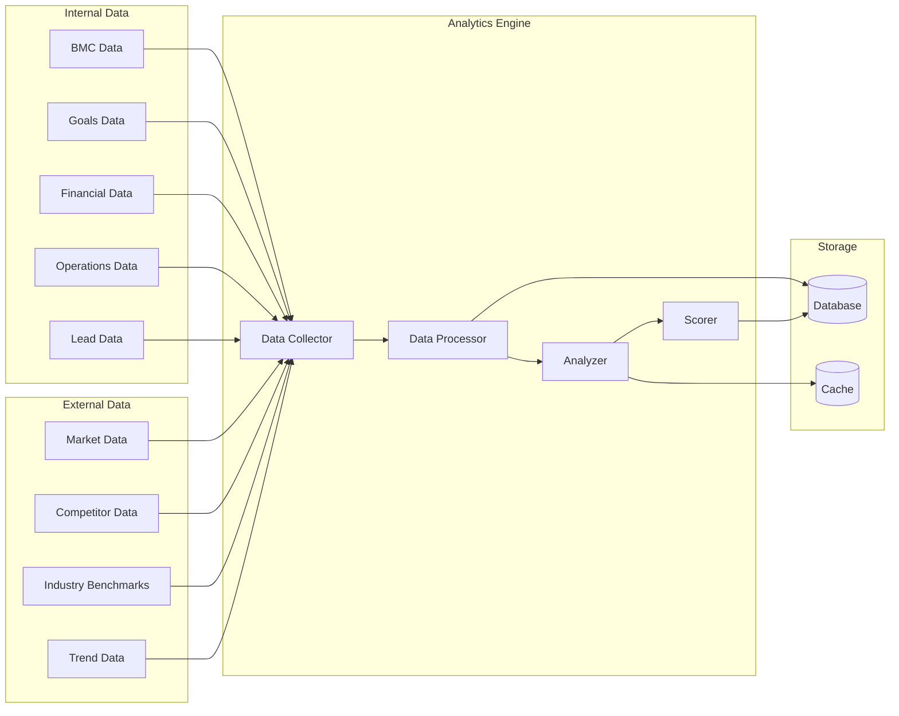
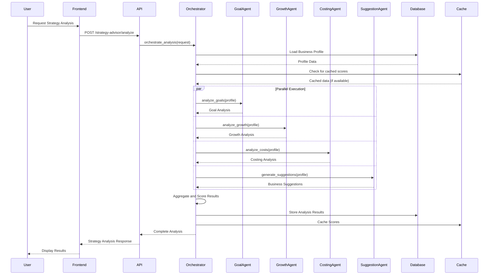
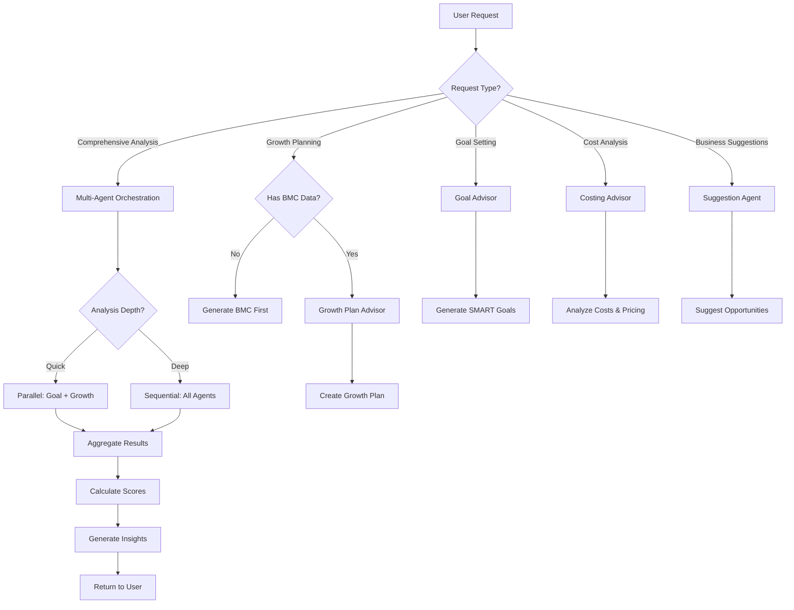
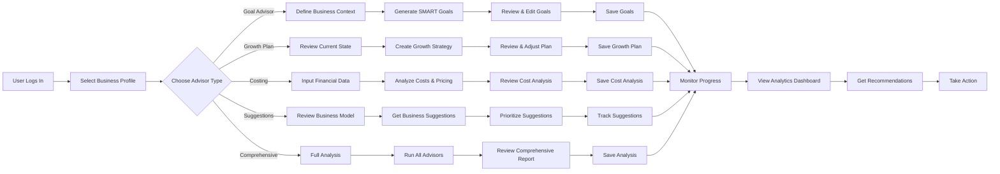

# Multi-Agent Strategy Advisor System Design

## Executive Summary

This document outlines the comprehensive design for a multi-agent Strategy Advisor system that enhances the SME Toolkit with specialized advisory capabilities, advanced analytics, and intelligent scoring mechanisms. The system integrates seamlessly with existing infrastructure while introducing new specialized agents that work under a central coordinator for orchestrated business intelligence.

---

## 1. System Architecture

### 1.1 High-Level Architecture



### 1.2 Architecture Principles

1. **Modularity**: Each advisor agent is independently deployable and testable
2. **Centralized Coordination**: Strategy Orchestrator manages all agent interactions
3. **Data Consistency**: Shared state managed through database and cache
4. **Scalability**: Agents can be parallelized or scaled independently
5. **Extensibility**: New agents can be added without modifying existing ones

---

## 2. Agent Specifications

### 2.1 Goal Advisor Agent

**Purpose**: Helps businesses set SMART goals, aligns goals with business model, tracks progress

**Input Data Requirements**:
- Business Model Canvas data
- Current business context
- Existing goals (if any)
- Business stage (startup, growth, established)
- Industry information

**Output Format**:
```json
{
  "success": true,
  "goals": [
    {
      "id": "goal_001",
      "title": "Increase Monthly Revenue",
      "description": "Achieve $50,000 monthly recurring revenue",
      "category": "financial",
      "smart_criteria": {
        "specific": "Achieve $50,000 MRR",
        "measurable": "Track through Stripe dashboard",
        "achievable": "Based on current growth rate of 15%",
        "relevant": "Supports expansion to new markets",
        "time_bound": "By Q4 2024"
      },
      "bmc_alignment": {
        "aligned_blocks": ["revenueStreams", "customerSegments"],
        "alignment_score": 0.85,
        "gaps": []
      },
      "priority": "high",
      "estimated_completion": "2024-12-31",
      "key_milestones": [
        {
          "milestone": "Reach $30,000 MRR",
          "target_date": "2024-06-30",
          "metrics": ["monthly_revenue"]
        }
      ],
      "required_resources": ["sales_team", "marketing_budget"],
      "potential_obstacles": ["market_saturation", "competition"],
      "success_metrics": ["monthly_revenue", "customer_acquisition_cost"]
    }
  ],
  "goal_analysis": {
    "total_goals": 5,
    "by_category": {
      "financial": 2,
      "operational": 1,
      "market": 1,
      "innovation": 1
    },
    "alignment_score": 0.82,
    "feasibility_score": 0.75,
    "recommendations": [
      "Consider breaking down financial goals into quarterly targets",
      "Add operational efficiency goals to support growth"
    ]
  }
}
```

**Key Algorithms/Logic**:
1. SMART Goal Validation: Uses NLP to analyze goal statements against SMART criteria
2. BMC Alignment Analysis: Maps goals to BMC blocks and calculates alignment scores
3. Feasibility Assessment: Evaluates goals against current business metrics and resources
4. Milestone Generation: Creates intermediate milestones based on goal complexity
5. Progress Tracking: Integrates with existing CompanyGoal database model

**Integration Points**:
- Database: CompanyGoal table for persistence
- API: `/api/v1/strategy-advisor/goals` endpoints
- Frontend: Goal management section in StrategyAdvisor component
- Services: Growth Score Service for goal impact analysis

---

### 2.2 Growth Plan Advisor Agent

**Purpose**: Creates comprehensive growth strategies, identifies growth opportunities, provides actionable steps

**Input Data Requirements**:
- Business Model Canvas data
- Market analysis results
- Financial projections
- Current growth metrics
- Competitive landscape
- Business goals

**Output Format**:
```json
{
  "success": true,
  "growth_plan": {
    "plan_id": "gp_001",
    "title": "6-Month Growth Strategy",
    "timeframe": "6 months",
    "overall_growth_potential": 0.78,
    "growth_opportunities": [
      {
        "id": "opp_001",
        "title": "Market Expansion to Southeast Asia",
        "type": "market_expansion",
        "potential_revenue_impact": "$150,000",
        "confidence_score": 0.85,
        "required_investment": "$50,000",
        "expected_roi": "300%",
        "time_to_market": "3 months",
        "key_actions": [
          "Conduct market research in target countries",
          "Establish local partnerships",
          "Adapt marketing materials for local markets"
        ],
        "risks": ["regulatory_challenges", "cultural_differences"],
        "mitigation_strategies": ["hire_local_experts", "pilot_in_one_country"]
      }
    ],
    "growth_channels": [
      {
        "channel": "digital_marketing",
        "priority": "high",
        "expected_impact": "40% increase in leads",
        "budget_allocation": "$20,000",
        "tactics": [
          "SEO optimization",
          "Content marketing",
          "Paid social media ads"
        ]
      }
    ],
    "implementation_roadmap": [
      {
        "phase": "Phase 1: Foundation",
        "duration": "Month 1-2",
        "objectives": ["Market research", "Team hiring"],
        "deliverables": ["Market research report", "Hired 2 sales reps"],
        "success_criteria": ["Research completed", "Team onboarded"]
      }
    ],
    "resource_requirements": {
      "team": ["sales_manager", "marketing_specialist"],
      "budget": "$100,000",
      "tools": ["CRM_system", "analytics_platform"]
    },
    "kpi_targets": {
      "revenue_growth": "50%",
      "customer_acquisition": "200 new customers",
      "market_penetration": "5% in target segment"
    },
    "risk_assessment": {
      "high_risks": [
        {
          "risk": "Market entry barriers",
          "probability": 0.6,
          "impact": "high",
          "mitigation": "Partner with established local players"
        }
      ]
    }
  }
}
```

**Key Algorithms/Logic**:
1. Opportunity Identification: Analyzes BMC, market data, and financials to find growth vectors
2. Growth Channel Prioritization: Scores channels based on ROI, feasibility, and alignment
3. Roadmap Generation: Creates phased implementation plans with dependencies
4. Resource Optimization: Allocates resources across opportunities for maximum impact
5. Risk-Adjusted ROI: Calculates expected returns factoring in probability and impact

**Integration Points**:
- Database: GrowthPlan table for persistence
- API: `/api/v1/strategy-advisor/growth-plans` endpoints
- Frontend: Growth plan visualization in StrategyAdvisor
- Services: Integrates with Growth Agent and Market Agent for data

---

### 2.3 Costing Advisor Agent

**Purpose**: Analyzes costs, provides pricing strategies, identifies cost optimization opportunities

**Input Data Requirements**:
- Business Model Canvas (cost structure, revenue streams)
- Financial data (current costs, margins)
- Market pricing data
- Competitor pricing
- Operational metrics

**Output Format**:
```json
{
  "success": true,
  "costing_analysis": {
    "current_cost_structure": {
      "fixed_costs": {
        "total": "$25,000/month",
        "breakdown": [
          {"category": "rent", "amount": "$8,000", "percentage": 32},
          {"category": "salaries", "amount": "$15,000", "percentage": 60},
          {"category": "software", "amount": "$2,000", "percentage": 8}
        ]
      },
      "variable_costs": {
        "total": "$15,000/month",
        "breakdown": [
          {"category": "materials", "amount": "$8,000", "percentage": 53},
          {"category": "shipping", "amount": "$4,000", "percentage": 27},
          {"category": "commissions", "amount": "$3,000", "percentage": 20}
        ]
      },
      "total_monthly_cost": "$40,000",
      "cost_per_unit": "$20"
    },
    "pricing_strategies": [
      {
        "strategy": "value_based_pricing",
        "recommended_price": "$45",
        "rationale": "Based on customer value perception and market positioning",
        "expected_margin": "55%",
        "market_position": "premium",
        "target_customers": "enterprise_segment"
      },
      {
        "strategy": "competitive_pricing",
        "recommended_price": "$35",
        "rationale": "Aligns with market average while maintaining margin",
        "expected_margin": "43%",
        "market_position": "mid_market",
        "target_customers": "mid_market_segment"
      }
    ],
    "optimization_opportunities": [
      {
        "area": "procurement",
        "current_cost": "$8,000/month",
        "potential_savings": "$1,200/month",
        "savings_percentage": 15,
        "actions": [
          "Negotiate bulk discounts with suppliers",
          "Source alternative suppliers",
          "Implement just-in-time inventory"
        ],
        "implementation_effort": "medium",
        "time_to_impact": "2 months"
      },
      {
        "area": "operations",
        "current_cost": "$10,000/month",
        "potential_savings": "$2,000/month",
        "savings_percentage": 20,
        "actions": [
          "Automate manual processes",
          "Optimize resource allocation",
          "Reduce waste in production"
        ],
        "implementation_effort": "high",
        "time_to_impact": "4 months"
      }
    ],
    "break_even_analysis": {
      "current_price": "$40",
      "break_even_units": 1,000,
      "break_even_revenue": "$40,000",
      "margin_of_safety": "60%",
      "sensitivity_analysis": {
        "price_increase_10%": {
          "new_break_even": 909,
          "additional_profit": "$4,000/month"
        }
      }
    },
    "cost_benchmarks": {
      "industry_average": {
        "cost_of_goods_sold": "65%",
        "operating_expenses": "25%",
        "your_business": {
          "cost_of_goods_sold": "60%",
          "operating_expenses": "30%"
        }
      },
      "performance": "above_average"
    }
  }
}
```

**Key Algorithms/Logic**:
1. Cost Structure Analysis: Categorizes and analyzes fixed vs variable costs
2. Pricing Strategy Generation: Creates multiple pricing strategies based on value, competition, and cost-plus
3. Optimization Opportunity Detection: Identifies cost-saving opportunities using pattern recognition
4. Break-Even Analysis: Calculates break-even points and performs sensitivity analysis
5. Benchmarking: Compares costs against industry standards

**Integration Points**:
- Database: CostingAnalysis table for historical tracking
- API: `/api/v1/strategy-advisor/costing` endpoints
- Frontend: Costing dashboard in StrategyAdvisor
- Services: Integrates with Finance Agent for financial data

---

### 2.4 Business Suggestion Agent

**Purpose**: Suggests new business opportunities, partnerships, revenue streams, market expansions

**Input Data Requirements**:
- Business Model Canvas
- Market analysis
- Current capabilities and resources
- Industry trends
- Customer feedback
- Competitive landscape

**Output Format**:
```json
{
  "success": true,
  "business_suggestions": {
    "new_opportunities": [
      {
        "id": "opp_001",
        "title": "B2B Subscription Service",
        "type": "new_revenue_stream",
        "description": "Launch a subscription-based service for enterprise clients",
        "potential_revenue": "$200,000/year",
        "investment_required": "$50,000",
        "time_to_market": "4 months",
        "feasibility_score": 0.85,
        "alignment_with_current_business": 0.90,
        "key_advantages": [
          "Leverages existing technology",
          "Utilizes current customer base",
          "Creates recurring revenue"
        ],
        "implementation_steps": [
          "Develop enterprise features",
          "Create pricing tiers",
          "Build sales team for B2B",
          "Establish support infrastructure"
        ],
        "risks": ["longer_sales_cycle", "higher_support_costs"],
        "success_probability": 0.75
      }
    ],
    "partnership_opportunities": [
      {
        "id": "partner_001",
        "title": "Strategic Partnership with Logistics Provider",
        "type": "strategic_partnership",
        "partner_type": "logistics",
        "potential_benefits": [
          "Reduced shipping costs by 20%",
          "Expanded delivery network",
          "Improved customer experience"
        ],
        "required_commitment": "Exclusive 2-year contract",
        "estimated_value": "$30,000/year in savings",
        "alignment_score": 0.88
      }
    ],
    "market_expansions": [
      {
        "id": "exp_001",
        "title": "Entry into Healthcare Sector",
        "type": "market_expansion",
        "target_market": "healthcare",
        "market_size": "$5B",
        "growth_rate": "12%/year",
        "entry_strategy": "partnership_with_healthcare_providers",
        "required_investments": ["regulatory_compliance", "specialized_features"],
        "competitive_advantage": "existing_technology_platform",
        "timeline": "6-9 months",
        "potential_revenue": "$500,000/year"
      }
    ],
    "innovation_suggestions": [
      {
        "id": "inn_001",
        "title": "AI-Powered Personalization",
        "type": "product_innovation",
        "description": "Implement machine learning for personalized recommendations",
        "development_effort": "medium",
        "potential_impact": "25% increase in conversion",
        "required_resources": ["ml_engineer", "data_scientist"],
        "competitive_advantage": "first_mover_in_market"
      }
    ],
    "prioritized_recommendations": [
      {
        "rank": 1,
        "suggestion_id": "opp_001",
        "reason": "Highest ROI and alignment with current business",
        "expected_value": "$200,000/year"
      }
    ]
  }
}
```

**Key Algorithms/Logic**:
1. Opportunity Scoring: Scores opportunities based on feasibility, alignment, and potential
2. Gap Analysis: Identifies market gaps and unmet customer needs
3. Capability Matching: Matches opportunities with existing business capabilities
4. Trend Analysis: Leverages market trends to identify emerging opportunities
5. Portfolio Optimization: Prioritizes suggestions for maximum business value

**Integration Points**:
- Database: BusinessSuggestion table for tracking
- API: `/api/v1/strategy-advisor/suggestions` endpoints
- Frontend: Suggestions panel in StrategyAdvisor
- Services: Integrates with Market Agent and Ideation Agent

---

## 3. Analytics Framework

### 3.1 Metrics to Track

#### 3.1.1 Business Health Metrics
- **Revenue Metrics**: MRR, ARR, Revenue Growth Rate, Churn Rate
- **Customer Metrics**: CAC, LTV, Customer Satisfaction (NPS), Retention Rate
- **Operational Metrics**: Operational Efficiency, Resource Utilization, Process Cycle Time
- **Financial Metrics**: Gross Margin, Net Margin, Burn Rate, Runway

#### 3.1.2 Growth Metrics
- **Market Metrics**: Market Share, Market Penetration, Brand Awareness
- **Acquisition Metrics**: Lead Conversion Rate, Sales Velocity, Pipeline Value
- **Product Metrics**: Feature Adoption, Usage Frequency, User Engagement
- **Innovation Metrics**: R&D Investment, New Product Success Rate, Time to Market

#### 3.1.3 Competitive Metrics
- **Positioning Metrics**: Price Competitiveness, Feature Parity, Service Quality
- **Differentiation Metrics**: Unique Value Proposition Score, Innovation Index
- **Market Dynamics**: Competitive Intensity, Market Growth Rate, Entry Barriers

### 3.2 Data Sources



### 3.3 Calculation Methods

#### 3.3.1 Real-Time Calculations
- **Current Scores**: Calculated on-demand using latest data
- **Trend Analysis**: Computed from historical data points
- **Comparative Analysis**: Benchmarked against industry standards
- **Alert Generation**: Triggered when metrics cross thresholds

#### 3.3.2 Stored Calculations
- **Historical Scores**: Stored daily/weekly for trend analysis
- **Aggregated Metrics**: Pre-computed for dashboard performance
- **Benchmark Comparisons**: Cached for quick access
- **Forecast Models**: Updated periodically with new data

### 3.4 Visualization Approach

#### 3.3.1 Dashboard Components
1. **Score Cards**: Display key scores with trend indicators
2. **Trend Charts**: Line charts showing metric evolution over time
3. **Comparison Charts**: Bar charts comparing against benchmarks
4. **Heat Maps**: Visual representation of performance across dimensions
5. **Progress Trackers**: Goal progress visualization
6. **Alert Panels**: Real-time alerts and notifications

#### 3.3.2 Interactive Features
- **Drill-down**: Click to explore detailed metrics
- **Time Range Selection**: View different time periods
- **Benchmark Toggle**: Compare against different standards
- **Scenario Modeling**: What-if analysis capabilities
- **Export Options**: Download reports in various formats

---

## 4. Scoring System

### 4.1 Score Categories

#### 4.1.1 Business Health Score (0-100)

**Sub-Metrics**:
- Financial Health (30%): Revenue stability, profitability, cash flow
- Operational Efficiency (25%): Process optimization, resource utilization
- Customer Satisfaction (20%): NPS, retention, feedback quality
- Market Position (15%): Market share, brand strength, competitive position
- Innovation Readiness (10%): R&D investment, innovation culture

**Weighting Formula**:
```
Business Health Score = 
  (Financial Health × 0.30) +
  (Operational Efficiency × 0.25) +
  (Customer Satisfaction × 0.20) +
  (Market Position × 0.15) +
  (Innovation Readiness × 0.10)
```

**Threshold Definitions**:
- 90-100: Excellent - Business is thriving
- 80-89: Good - Strong performance with minor improvements needed
- 70-79: Fair - Adequate performance, room for improvement
- 60-69: Poor - Significant issues requiring attention
- 0-59: Critical - Immediate action required

#### 4.1.2 Growth Potential Score (0-100)

**Sub-Metrics**:
- Market Opportunity (35%): Market size, growth rate, accessibility
- Competitive Advantage (25%): Differentiation, barriers to entry
- Execution Capability (20%): Team, resources, processes
- Financial Capacity (15%): Funding, runway, investment readiness
- Innovation Potential (5%): R&D, technology, adaptability

**Weighting Formula**:
```
Growth Potential Score = 
  (Market Opportunity × 0.35) +
  (Competitive Advantage × 0.25) +
  (Execution Capability × 0.20) +
  (Financial Capacity × 0.15) +
  (Innovation Potential × 0.05)
```

#### 4.1.3 Financial Stability Score (0-100)

**Sub-Metrics**:
- Revenue Stability (30%): Revenue consistency, predictability
- Profitability (25%): Margins, profitability trends
- Cash Flow Health (20%): Cash position, burn rate
- Debt Management (15%): Debt ratios, leverage
- Funding Readiness (10%): Access to capital, investor interest

**Weighting Formula**:
```
Financial Stability Score = 
  (Revenue Stability × 0.30) +
  (Profitability × 0.25) +
  (Cash Flow Health × 0.20) +
  (Debt Management × 0.15) +
  (Funding Readiness × 0.10)
```

#### 4.1.4 Market Position Score (0-100)

**Sub-Metrics**:
- Market Share (30%): Current market penetration
- Brand Strength (25%): Brand awareness, reputation
- Competitive Positioning (20%): Differentiation, value proposition
- Customer Loyalty (15%): Retention, advocacy
- Market Influence (10%): Thought leadership, industry impact

**Weighting Formula**:
```
Market Position Score = 
  (Market Share × 0.30) +
  (Brand Strength × 0.25) +
  (Competitive Positioning × 0.20) +
  (Customer Loyalty × 0.15) +
  (Market Influence × 0.10)
```

#### 4.1.5 Operational Efficiency Score (0-100)

**Sub-Metrics**:
- Process Efficiency (30%): Workflow optimization, automation
- Resource Utilization (25%): Asset efficiency, team productivity
- Cost Management (20%): Cost control, optimization
- Quality Metrics (15%): Error rates, customer satisfaction
- Scalability (10%): Ability to scale operations

**Weighting Formula**:
```
Operational Efficiency Score = 
  (Process Efficiency × 0.30) +
  (Resource Utilization × 0.25) +
  (Cost Management × 0.20) +
  (Quality Metrics × 0.15) +
  (Scalability × 0.10)
```

#### 4.1.6 Innovation Readiness Score (0-100)

**Sub-Metrics**:
- R&D Investment (30%): Investment in research and development
- Innovation Culture (25%): Team mindset, experimentation
- Technology Adoption (20%): Use of modern technologies
- Idea Generation (15%): Flow of new ideas
- Innovation Success Rate (10%): Conversion of ideas to products

**Weighting Formula**:
```
Innovation Readiness Score = 
  (R&D Investment × 0.30) +
  (Innovation Culture × 0.25) +
  (Technology Adoption × 0.20) +
  (Idea Generation × 0.15) +
  (Innovation Success Rate × 0.10)
```

### 4.2 Score Interpretation Guidelines

#### 4.2.1 Score Ranges
- **90-100**: Excellent - Best-in-class performance
- **80-89**: Very Good - Strong performance, minor improvements
- **70-79**: Good - Solid performance, some areas for improvement
- **60-69**: Fair - Adequate but needs attention
- **50-59**: Poor - Significant issues
- **Below 50**: Critical - Immediate action required

#### 4.2.2 Trend Analysis
- **Improving**: Score increased by 5+ points over last period
- **Stable**: Score changed by less than 5 points
- **Declining**: Score decreased by 5+ points over last period

#### 4.2.3 Action Recommendations
- **90-100**: Maintain excellence, explore new opportunities
- **80-89**: Optimize strengths, address minor weaknesses
- **70-79**: Focus on improvement areas
- **60-69**: Prioritize addressing weaknesses
- **Below 60**: Immediate intervention required

---

## 5. Orchestration Flow

### 5.1 Agent Interaction Protocol



### 5.2 Decision Tree for Agent Selection



### 5.3 User Workflow



### 5.4 API Endpoints Required

#### 5.4.1 Strategy Advisor Endpoints
```
POST   /api/v1/strategy-advisor/analyze
GET    /api/v1/strategy-advisor/analysis/{analysis_id}
POST   /api/v1/strategy-advisor/goals
GET    /api/v1/strategy-advisor/goals
PUT    /api/v1/strategy-advisor/goals/{goal_id}
DELETE /api/v1/strategy-advisor/goals/{goal_id}
POST   /api/v1/strategy-advisor/growth-plans
GET    /api/v1/strategy-advisor/growth-plans
POST   /api/v1/strategy-advisor/costing/analyze
GET    /api/v1/strategy-advisor/costing/{analysis_id}
POST   /api/v1/strategy-advisor/suggestions
GET    /api/v1/strategy-advisor/suggestions
```

#### 5.4.2 Analytics Endpoints
```
GET    /api/v1/analytics/dashboard
GET    /api/v1/analytics/metrics
GET    /api/v1/analytics/trends
GET    /api/v1/analytics/benchmarks
POST   /api/v1/analytics/custom-report
```

#### 5.4.3 Scoring Endpoints
```
GET    /api/v1/scoring/current
GET    /api/v1/scoring/history
GET    /api/v1/scoring/{score_type}
POST   /api/v1/scoring/recalculate
GET    /api/v1/scoring/benchmarks
```

#### 5.4.4 Orchestration Endpoints
```
POST   /api/v1/orchestration/analyze
GET    /api/v1/orchestration/status/{job_id}
POST   /api/v1/orchestration/parallel
POST   /api/v1/orchestration/sequential
```

---

## 6. Implementation Roadmap

### 6.1 Phase 1: Core Infrastructure (Foundation)

**Objectives**:
- Establish database schema for new features
- Create base services and utilities
- Set up caching layer
- Implement basic API structure

**Tasks**:
1. Database Schema Design
   - Create new tables: StrategyAnalysis, GrowthPlan, CostingAnalysis, BusinessSuggestion
   - Extend existing tables: BusinessProfile, CompanyGoal
   - Add indexes for performance
   - Create migration scripts

2. Service Layer Foundation
   - Create StrategyOrchestrator service
   - Implement AnalyticsService base class
   - Create ScoringService with calculation engines
   - Set up caching service with Redis

3. API Infrastructure
   - Create strategy-advisor router
   - Create analytics router
   - Create scoring router
   - Implement authentication and authorization

4. Frontend Foundation
   - Create StrategyAdvisorContext
   - Set up API client services
   - Create base components for advisors
   - Implement loading and error states

**Deliverables**:
- Updated database schema
- Base service classes
- API router structure
- Frontend context and base components

---

### 6.2 Phase 2: Initial Agents (Core Advisors)

**Objectives**:
- Implement the four core advisor agents
- Create agent orchestration logic
- Integrate with existing system

**Tasks**:
1. Goal Advisor Agent
   - Implement GoalAdvisorAgent class
   - Create SMART goal validation logic
   - Implement BMC alignment analysis
   - Create goal tracking integration
   - Add prompts and templates

2. Growth Plan Advisor Agent
   - Implement GrowthPlanAdvisorAgent class
   - Create opportunity identification logic
   - Implement roadmap generation
   - Add resource optimization algorithms
   - Create risk assessment module

3. Costing Advisor Agent
   - Implement CostingAdvisorAgent class
   - Create cost structure analysis
   - Implement pricing strategy generation
   - Add optimization opportunity detection
   - Create break-even analysis

4. Business Suggestion Agent
   - Implement BusinessSuggestionAgent class
   - Create opportunity scoring logic
   - Implement gap analysis
   - Add capability matching
   - Create trend analysis integration

5. Agent Orchestration
   - Enhance StrategyOrchestrator
   - Implement parallel execution
   - Add sequential execution patterns
   - Create result aggregation logic
   - Implement conflict resolution

**Deliverables**:
- Four advisor agent implementations
- Enhanced orchestrator
- Agent integration tests
- API endpoints for each agent

---

### 6.3 Phase 3: Advanced Features (Analytics & Scoring)

**Objectives**:
- Implement comprehensive analytics system
- Create scoring framework
- Add visualization components

**Tasks**:
1. Analytics System
   - Implement data collection pipeline
   - Create metric calculation engines
   - Add trend analysis algorithms
   - Implement benchmark comparison
   - Create forecasting models

2. Scoring System
   - Implement all six score calculators
   - Create weighting formulas
   - Add threshold definitions
   - Implement score interpretation logic
   - Create historical tracking

3. Visualization Components
   - Create dashboard components
   - Implement score cards
   - Add trend charts
   - Create comparison visualizations
   - Implement heat maps

4. Real-Time Features
   - Implement WebSocket for real-time updates
   - Add alert system
   - Create notification system
   - Implement live score updates

**Deliverables**:
- Complete analytics system
- Scoring framework implementation
- Dashboard components
- Real-time update system

---

### 6.4 Phase 4: Optimization and Scaling (Enhancement)

**Objectives**:
- Optimize performance
- Add advanced features
- Scale for production

**Tasks**:
1. Performance Optimization
   - Implement query optimization
   - Add database indexing
   - Optimize caching strategy
   - Implement lazy loading
   - Add pagination

2. Advanced Features
   - Implement scenario modeling
   - Add what-if analysis
   - Create predictive analytics
   - Implement AI-powered recommendations
   - Add collaborative features

3. Testing & Quality
   - Implement comprehensive unit tests
   - Add integration tests
   - Create performance tests
   - Implement E2E tests
   - Add load testing

4. Documentation & Training
   - Create API documentation
   - Write user guides
   - Create developer documentation
   - Add inline code comments
   - Create training materials

**Deliverables**:
- Optimized system
- Advanced features
- Comprehensive test suite
- Complete documentation

---

## 7. Technical Specifications

### 7.1 Database Schema Changes

#### 7.1.1 New Tables

**strategy_analysis**
```sql
CREATE TABLE strategy_analysis (
    id VARCHAR(36) PRIMARY KEY,
    business_profile_id VARCHAR(36) NOT NULL,
    analysis_type VARCHAR(50) NOT NULL,
    results JSON NOT NULL,
    scores JSON,
    insights JSON,
    created_at DATETIME DEFAULT CURRENT_TIMESTAMP,
    updated_at DATETIME DEFAULT CURRENT_TIMESTAMP ON UPDATE CURRENT_TIMESTAMP,
    FOREIGN KEY (business_profile_id) REFERENCES business_profiles(id)
);
```

**growth_plans**
```sql
CREATE TABLE growth_plans (
    id VARCHAR(36) PRIMARY KEY,
    business_profile_id VARCHAR(36) NOT NULL,
    title VARCHAR(255) NOT NULL,
    timeframe VARCHAR(50),
    plan_data JSON NOT NULL,
    status VARCHAR(50) DEFAULT 'draft',
    created_at DATETIME DEFAULT CURRENT_TIMESTAMP,
    updated_at DATETIME DEFAULT CURRENT_TIMESTAMP ON UPDATE CURRENT_TIMESTAMP,
    FOREIGN KEY (business_profile_id) REFERENCES business_profiles(id)
);
```

**costing_analysis**
```sql
CREATE TABLE costing_analysis (
    id VARCHAR(36) PRIMARY KEY,
    business_profile_id VARCHAR(36) NOT NULL,
    analysis_date DATETIME DEFAULT CURRENT_TIMESTAMP,
    cost_structure JSON NOT NULL,
    pricing_strategies JSON,
    optimization_opportunities JSON,
    break_even_analysis JSON,
    created_at DATETIME DEFAULT CURRENT_TIMESTAMP,
    FOREIGN KEY (business_profile_id) REFERENCES business_profiles(id)
);
```

**business_suggestions**
```sql
CREATE TABLE business_suggestions (
    id VARCHAR(36) PRIMARY KEY,
    business_profile_id VARCHAR(36) NOT NULL,
    suggestion_type VARCHAR(50) NOT NULL,
    title VARCHAR(255) NOT NULL,
    description TEXT,
    potential_value DECIMAL(15,2),
    feasibility_score DECIMAL(3,2),
    status VARCHAR(50) DEFAULT 'suggested',
    created_at DATETIME DEFAULT CURRENT_TIMESTAMP,
    FOREIGN KEY (business_profile_id) REFERENCES business_profiles(id)
);
```

**score_records**
```sql
CREATE TABLE score_records (
    id VARCHAR(36) PRIMARY KEY,
    business_profile_id VARCHAR(36) NOT NULL,
    score_type VARCHAR(50) NOT NULL,
    overall_score DECIMAL(5,2) NOT NULL,
    sub_metrics JSON NOT NULL,
    calculated_at DATETIME DEFAULT CURRENT_TIMESTAMP,
    FOREIGN KEY (business_profile_id) REFERENCES business_profiles(id),
    INDEX idx_business_score_type (business_profile_id, score_type),
    INDEX idx_calculated_at (calculated_at)
);
```

**analytics_metrics**
```sql
CREATE TABLE analytics_metrics (
    id VARCHAR(36) PRIMARY KEY,
    business_profile_id VARCHAR(36) NOT NULL,
    metric_name VARCHAR(100) NOT NULL,
    metric_value DECIMAL(15,2),
    metric_unit VARCHAR(50),
    recorded_at DATETIME DEFAULT CURRENT_TIMESTAMP,
    metadata JSON,
    FOREIGN KEY (business_profile_id) REFERENCES business_profiles(id),
    INDEX idx_business_metric (business_profile_id, metric_name),
    INDEX idx_recorded_at (recorded_at)
);
```

#### 7.1.2 Extended Tables

**business_profiles** (Additions)
```sql
ALTER TABLE business_profiles ADD COLUMN strategy_settings JSON;
ALTER TABLE business_profiles ADD COLUMN scoring_preferences JSON;
ALTER TABLE business_profiles ADD COLUMN analytics_config JSON;
```

**company_goals** (Additions)
```sql
ALTER TABLE company_goals ADD COLUMN smart_criteria JSON;
ALTER TABLE company_goals ADD COLUMN bmc_alignment JSON;
ALTER TABLE company_goals ADD COLUMN milestones JSON;
ALTER TABLE company_goals ADD COLUMN success_metrics JSON;
```

### 7.2 New API Endpoints

#### 7.2.1 Strategy Advisor API

```python
# sme-toolkit-backend/app/api/v1/endpoints/strategy_advisor.py

@router.post("/analyze")
async def analyze_strategy(
    request: StrategyAnalysisRequest,
    current_user: str = Depends(get_current_user)
):
    """
    Perform comprehensive strategy analysis using multiple advisors
    """
    pass

@router.post("/goals")
async def create_goals(
    request: GoalCreationRequest,
    current_user: str = Depends(get_current_user)
):
    """
    Generate SMART goals using Goal Advisor
    """
    pass

@router.get("/goals")
async def get_goals(
    business_profile_id: str,
    current_user: str = Depends(get_current_user)
):
    """
    Retrieve all goals for a business profile
    """
    pass

@router.put("/goals/{goal_id}")
async def update_goal(
    goal_id: str,
    request: GoalUpdateRequest,
    current_user: str = Depends(get_current_user)
):
    """
    Update a specific goal
    """
    pass

@router.post("/growth-plans")
async def create_growth_plan(
    request: GrowthPlanRequest,
    current_user: str = Depends(get_current_user)
):
    """
    Create growth plan using Growth Plan Advisor
    """
    pass

@router.get("/growth-plans")
async def get_growth_plans(
    business_profile_id: str,
    current_user: str = Depends(get_current_user)
):
    """
    Retrieve all growth plans
    """
    pass

@router.post("/costing/analyze")
async def analyze_costing(
    request: CostingAnalysisRequest,
    current_user: str = Depends(get_current_user)
):
    """
    Analyze costs and pricing using Costing Advisor
    """
    pass

@router.post("/suggestions")
async def get_suggestions(
    request: SuggestionRequest,
    current_user: str = Depends(get_current_user)
):
    """
    Generate business suggestions using Suggestion Agent
    """
    pass
```

#### 7.2.2 Analytics API

```python
# sme-toolkit-backend/app/api/v1/endpoints/analytics.py

@router.get("/dashboard")
async def get_dashboard_data(
    business_profile_id: str,
    time_range: str = "30d",
    current_user: str = Depends(get_current_user)
):
    """
    Get comprehensive dashboard data
    """
    pass

@router.get("/metrics")
async def get_metrics(
    business_profile_id: str,
    metric_names: List[str],
    time_range: str = "30d",
    current_user: str = Depends(get_current_user)
):
    """
    Get specific metrics
    """
    pass

@router.get("/trends")
async def get_trends(
    business_profile_id: str,
    metric_name: str,
    time_range: str = "90d",
    current_user: str = Depends(get_current_user)
):
    """
    Get trend analysis for a metric
    """
    pass

@router.get("/benchmarks")
async def get_benchmarks(
    business_profile_id: str,
    industry: str,
    current_user: str = Depends(get_current_user)
):
    """
    Get industry benchmarks
    """
    pass
```

#### 7.2.3 Scoring API

```python
# sme-toolkit-backend/app/api/v1/endpoints/scoring.py

@router.get("/current")
async def get_current_scores(
    business_profile_id: str,
    current_user: str = Depends(get_current_user)
):
    """
    Get current scores for all categories
    """
    pass

@router.get("/history")
async def get_score_history(
    business_profile_id: str,
    score_type: str,
    time_range: str = "90d",
    current_user: str = Depends(get_current_user)
):
    """
    Get historical score data
    """
    pass

@router.get("/{score_type}")
async def get_score_details(
    business_profile_id: str,
    score_type: str,
    current_user: str = Depends(get_current_user)
):
    """
    Get detailed breakdown of a specific score
    """
    pass

@router.post("/recalculate")
async def recalculate_scores(
    business_profile_id: str,
    current_user: str = Depends(get_current_user)
):
    """
    Trigger score recalculation
    """
    pass
```

### 7.3 Frontend Component Updates

#### 7.3.1 Enhanced StrategyAdvisor Component

```typescript
// components/StrategyAdvisor.tsx

interface StrategyAdvisorProps {
  businessProfileId: string;
}

interface AdvisorTab {
  id: 'goals' | 'growth' | 'costing' | 'suggestions' | 'comprehensive';
  label: string;
  icon: LucideIcon;
}

const StrategyAdvisor: React.FC<StrategyAdvisorProps> = ({ businessProfileId }) => {
  const [activeTab, setActiveTab] = useState<AdvisorTab['id']>('comprehensive');
  const [analysisData, setAnalysisData] = useState<AnalysisData | null>(null);
  const [loading, setLoading] = useState(false);
  
  // Sub-components for each advisor
  const renderGoalsAdvisor = () => <GoalsAdvisor businessProfileId={businessProfileId} />;
  const renderGrowthAdvisor = () => <GrowthPlanAdvisor businessProfileId={businessProfileId} />;
  const renderCostingAdvisor = () => <CostingAdvisor businessProfileId={businessProfileId} />;
  const renderSuggestionsAdvisor = () => <SuggestionsAdvisor businessProfileId={businessProfileId} />;
  const renderComprehensiveAnalysis = () => <ComprehensiveAnalysis businessProfileId={businessProfileId} />;
  
  return (
    <div className="strategy-advisor">
      <AdvisorTabs activeTab={activeTab} onTabChange={setActiveTab} />
      <AdvisorContent>
        {activeTab === 'goals' && renderGoalsAdvisor()}
        {activeTab === 'growth' && renderGrowthAdvisor()}
        {activeTab === 'costing' && renderCostingAdvisor()}
        {activeTab === 'suggestions' && renderSuggestionsAdvisor()}
        {activeTab === 'comprehensive' && renderComprehensiveAnalysis()}
      </AdvisorContent>
    </div>
  );
};
```

#### 7.3.2 New Components

**GoalsAdvisor.tsx**
- SMART goal generation interface
- Goal tracking dashboard
- Progress visualization
- Milestone management

**GrowthPlanAdvisor.tsx**
- Growth plan creation wizard
- Opportunity visualization
- Roadmap timeline
- Resource allocation view

**CostingAdvisor.tsx**
- Cost structure breakdown
- Pricing strategy comparison
- Optimization opportunities list
- Break-even analysis chart

**SuggestionsAdvisor.tsx**
- Opportunity cards
- Partnership suggestions
- Market expansion options
- Innovation ideas

**ComprehensiveAnalysis.tsx**
- Multi-agent results aggregation
- Score dashboard
- Trend charts
- Actionable insights

**AnalyticsDashboard.tsx**
- Key metrics overview
- Trend visualizations
- Benchmark comparisons
- Real-time alerts

**ScoreCards.tsx**
- Individual score displays
- Trend indicators
- Drill-down capability
- Historical comparison

### 7.4 Service Layer Additions

#### 7.4.1 Strategy Orchestrator Service

```python
# sme-toolkit-backend/app/services/strategy_orchestrator.py

class StrategyOrchestrator:
    """
    Central coordinator for all strategy advisor agents
    Manages agent execution, data flow, and result aggregation
    """
    
    def __init__(self, db: AsyncSession):
        self.db = db
        self.goal_advisor = GoalAdvisorAgent()
        self.growth_advisor = GrowthPlanAdvisorAgent()
        self.costing_advisor = CostingAdvisorAgent()
        self.suggestion_advisor = BusinessSuggestionAgent()
        self.scoring_service = ScoringService(db)
        self.analytics_service = AnalyticsService(db)
    
    async def analyze_comprehensive(
        self,
        business_profile_id: str,
        analysis_config: Dict[str, Any]
    ) -> Dict[str, Any]:
        """
        Execute comprehensive analysis using all advisors
        """
        # Load business profile data
        profile = await self._load_profile(business_profile_id)
        
        # Execute agents in parallel
        results = await self._execute_agents_parallel(profile, analysis_config)
        
        # Aggregate results
        aggregated = self._aggregate_results(results)
        
        # Calculate scores
        scores = await self.scoring_service.calculate_all_scores(profile, aggregated)
        
        # Generate insights
        insights = await self._generate_insights(profile, aggregated, scores)
        
        # Store analysis
        analysis_id = await self._store_analysis(
            business_profile_id,
            aggregated,
            scores,
            insights
        )
        
        return {
            "analysis_id": analysis_id,
            "results": aggregated,
            "scores": scores,
            "insights": insights
        }
    
    async def _execute_agents_parallel(
        self,
        profile: BusinessProfile,
        config: Dict[str, Any]
    ) -> Dict[str, Any]:
        """Execute multiple agents in parallel"""
        tasks = []
        
        if config.get("include_goals", True):
            tasks.append(self.goal_advisor.invoke({"bmc_data": profile.bmc_data}))
        
        if config.get("include_growth", True):
            tasks.append(self.growth_advisor.invoke({"bmc_data": profile.bmc_data}))
        
        if config.get("include_costing", True):
            tasks.append(self.costing_advisor.invoke({"bmc_data": profile.bmc_data}))
        
        if config.get("include_suggestions", True):
            tasks.append(self.suggestion_advisor.invoke({"bmc_data": profile.bmc_data}))
        
        results = await asyncio.gather(*tasks, return_exceptions=True)
        
        return {
            "goals": results[0] if len(results) > 0 else None,
            "growth": results[1] if len(results) > 1 else None,
            "costing": results[2] if len(results) > 2 else None,
            "suggestions": results[3] if len(results) > 3 else None
        }
```

#### 7.4.2 Scoring Service

```python
# sme-toolkit-backend/app/services/scoring_service.py

class ScoringService:
    """
    Service for calculating and managing business scores
    Supports both real-time and stored score calculations
    """
    
    def __init__(self, db: AsyncSession):
        self.db = db
        self.cache = RedisCache()
        self.calculators = {
            "business_health": BusinessHealthCalculator(),
            "growth_potential": GrowthPotentialCalculator(),
            "financial_stability": FinancialStabilityCalculator(),
            "market_position": MarketPositionCalculator(),
            "operational_efficiency": OperationalEfficiencyCalculator(),
            "innovation_readiness": InnovationReadinessCalculator()
        }
    
    async def calculate_all_scores(
        self,
        profile: BusinessProfile,
        analysis_data: Dict[str, Any]
    ) -> Dict[str, Any]:
        """
        Calculate all scores for a business profile
        """
        scores = {}
        
        for score_type, calculator in self.calculators.items():
            # Check cache first
            cache_key = f"score:{profile.id}:{score_type}"
            cached = await self.cache.get(cache_key)
            
            if cached:
                scores[score_type] = cached
            else:
                # Calculate score
                score_data = await calculator.calculate(profile, analysis_data)
                
                # Store in cache (5 minute TTL)
                await self.cache.set(cache_key, score_data, ttl=300)
                
                scores[score_type] = score_data
        
        return scores
    
    async def store_scores(
        self,
        business_profile_id: str,
        scores: Dict[str, Any]
    ) -> List[str]:
        """
        Store scores in database for historical tracking
        """
        record_ids = []
        
        for score_type, score_data in scores.items():
            record = ScoreRecord(
                id=str(uuid.uuid4()),
                business_profile_id=business_profile_id,
                score_type=score_type,
                overall_score=score_data["overall_score"],
                sub_metrics=score_data["sub_metrics"],
                calculated_at=datetime.utcnow()
            )
            
            self.db.add(record)
            record_ids.append(record.id)
        
        await self.db.commit()
        
        return record_ids
```

#### 7.4.3 Analytics Service

```python
# sme-toolkit-backend/app/services/analytics_service.py

class AnalyticsService:
    """
    Service for collecting, processing, and analyzing business metrics
    """
    
    def __init__(self, db: AsyncSession):
        self.db = db
        self.cache = RedisCache()
    
    async def collect_metrics(
        self,
        business_profile_id: str,
        metric_names: List[str]
    ) -> Dict[str, Any]:
        """
        Collect metrics from various sources
        """
        metrics = {}
        
        for metric_name in metric_names:
            # Check cache
            cache_key = f"metric:{business_profile_id}:{metric_name}"
            cached = await self.cache.get(cache_key)
            
            if cached:
                metrics[metric_name] = cached
            else:
                # Collect from source
                value = await self._collect_metric(business_profile_id, metric_name)
                
                # Store in cache
                await self.cache.set(cache_key, value, ttl=60)
                
                metrics[metric_name] = value
        
        return metrics
    
    async def analyze_trends(
        self,
        business_profile_id: str,
        metric_name: str,
        time_range: str = "90d"
    ) -> Dict[str, Any]:
        """
        Analyze trends for a specific metric
        """
        # Get historical data
        historical = await self._get_historical_data(
            business_profile_id,
            metric_name,
            time_range
        )
        
        # Calculate trend
        trend = self._calculate_trend(historical)
        
        # Generate insights
        insights = self._generate_trend_insights(historical, trend)
        
        return {
            "metric": metric_name,
            "time_range": time_range,
            "historical_data": historical,
            "trend": trend,
            "insights": insights
        }
```

---

## 8. New Business Agent Suggestions

### 8.1 Market Research Agent

**Purpose**: Conducts in-depth market research, analyzes market trends, and provides market intelligence

**Value Proposition**:
- Reduces time spent on manual market research
- Provides data-driven market insights
- Identifies emerging market opportunities
- Supports strategic decision-making with market data

**Use Cases**:
- Market entry analysis for new products/services
- Competitive landscape assessment
- Customer segment analysis
- Market sizing and forecasting
- Trend identification and analysis

**Key Capabilities**:
- Automated market data collection
- Competitor analysis and benchmarking
- Customer sentiment analysis
- Market trend prediction
- Opportunity identification

---

### 8.2 Competitive Intelligence Agent

**Purpose**: Monitors competitors, analyzes competitive strategies, and provides competitive advantage insights

**Value Proposition**:
- Keeps businesses informed about competitor activities
- Identifies competitive threats and opportunities
- Provides actionable competitive intelligence
- Supports strategic positioning decisions

**Use Cases**:
- Competitor product feature analysis
- Pricing strategy monitoring
- Marketing campaign tracking
- Market share analysis
- Competitive gap identification

**Key Capabilities**:
- Competitor monitoring and tracking
- Feature comparison analysis
- Pricing intelligence
- Market positioning analysis
- Threat assessment

---

### 8.3 Customer Insights Agent

**Purpose**: Analyzes customer behavior, feedback, and preferences to provide actionable customer insights

**Value Proposition**:
- Improves customer understanding
- Identifies customer pain points
- Enhances customer experience
- Drives customer-centric decisions

**Use Cases**:
- Customer segmentation analysis
- Churn prediction and prevention
- Customer satisfaction analysis
- Persona development
- Customer journey optimization

**Key Capabilities**:
- Customer behavior analysis
- Sentiment analysis from feedback
- Churn prediction modeling
- Customer lifetime value analysis
- Personalization recommendations

---

### 8.4 Risk Assessment Agent

**Purpose**: Identifies, analyzes, and mitigates business risks across all operational areas

**Value Proposition**:
- Proactive risk identification
- Comprehensive risk assessment
- Mitigation strategy recommendations
- Business continuity planning support

**Use Cases**:
- Financial risk assessment
- Operational risk analysis
- Market risk evaluation
- Compliance risk monitoring
- Strategic risk identification

**Key Capabilities**:
- Risk identification and categorization
- Probability and impact assessment
- Risk scoring and prioritization
- Mitigation strategy generation
- Risk monitoring and alerting

---

### 8.5 Compliance Agent

**Purpose**: Ensures business compliance with regulations, standards, and best practices

**Value Proposition**:
- Reduces compliance risk
- Automates compliance monitoring
- Provides regulatory updates
- Supports audit preparation

**Use Cases**:
- Regulatory compliance checking
- Data privacy compliance (GDPR, CCPA)
- Industry-specific compliance (HIPAA, SOX)
- Internal policy compliance
- Audit trail generation

**Key Capabilities**:
- Regulatory requirement tracking
- Compliance gap analysis
- Automated compliance checks
- Regulatory update monitoring
- Compliance reporting

---

### 8.6 Innovation Agent

**Purpose**: Identifies innovation opportunities, fosters creative thinking, and supports product innovation

**Value Proposition**:
- Accelerates innovation cycles
- Identifies untapped opportunities
- Supports creative problem-solving
- Enhances competitive differentiation

**Use Cases**:
- Product innovation ideation
- Process improvement suggestions
- Technology trend analysis
- Innovation opportunity scoring
- R&D prioritization

**Key Capabilities**:
- Trend analysis and forecasting
- Opportunity identification
- Idea generation and evaluation
- Innovation pipeline management
- Technology scouting

---

## 9. Integration with Existing System

### 9.1 StrategyAdvisor Component Integration

**Current State**:
- Simple tab-based interface with 4 advice types
- Direct API calls to strategy agent
- Basic text input and output

**Enhanced State**:
- Multi-tab interface with 5 advisor types
- Orchestrated agent execution
- Rich data visualization
- Interactive dashboards
- Real-time updates

**Integration Approach**:
1. Extend existing component with new tabs
2. Add sub-components for each advisor
3. Integrate with new API endpoints
4. Add state management for complex data
5. Implement caching for performance

### 9.2 Business Model Canvas Integration

**Data Flow**:
- BMC data serves as primary input for all advisors
- Advisors provide feedback to improve BMC
- Goals align with BMC blocks
- Growth plans reference BMC elements

**Integration Points**:
- BMC data loaded into advisor context
- Advisor results displayed alongside BMC
- BMC updates trigger advisor re-analysis
- Goal-BMC alignment visualization

### 9.3 Lead Management Integration

**Data Flow**:
- Lead data informs customer analysis
- Growth plans include lead generation strategies
- Customer insights from lead data

**Integration Points**:
- Lead metrics feed into analytics
- Growth strategies reference lead data
- Customer segmentation uses lead information

### 9.4 Growth Score Service Integration

**Enhancement**:
- Extend existing growth score with new score types
- Add historical tracking
- Implement real-time calculation
- Add benchmarking

**Integration Approach**:
1. Extend GrowthScoreCalculator with new calculators
2. Add score storage in database
3. Implement caching layer
4. Create API endpoints for new scores

### 9.5 Current Agent Ecosystem Integration

**Existing Agents**:
- Strategy Agent: General strategic advice
- Growth Agent: Growth analysis
- Finance Agent: Financial analysis
- Market Agent: Market analysis
- Operations Agent: Operational analysis

**New Advisor Agents**:
- Goal Advisor: Specialized goal setting
- Growth Plan Advisor: Detailed growth planning
- Costing Advisor: Cost and pricing analysis
- Business Suggestion Agent: Opportunity identification

**Integration Pattern**:
- New advisors complement existing agents
- Orchestrator coordinates all agents
- Data sharing through orchestrator
- Results aggregated for comprehensive analysis

---

## 10. Design Rationale

### 10.1 Architectural Decisions

**Why Central Coordinator?**
- Ensures consistent data flow across agents
- Manages agent dependencies and execution order
- Provides single point of control for orchestration
- Simplifies error handling and retry logic
- Enables parallel execution optimization

**Why Hybrid Scoring (Real-time + Stored)?**
- Real-time: Provides current, accurate scores
- Stored: Enables historical analysis and trend tracking
- Caching: Improves performance for frequent access
- Flexibility: Supports both use cases effectively

**Why New Advisor Agents Instead of Enhancing Existing?**
- Specialization: Each advisor focuses on specific domain
- Maintainability: Easier to update and test individual agents
- Scalability: Can scale agents independently
- Extensibility: Easy to add new advisors without affecting others

**Why LangGraph for Agent Implementation?**
- Already used in existing system
- Provides state management
- Supports complex workflows
- Enables visualization of agent graphs
- Integrates well with async/await patterns

### 10.2 Technology Choices

**Database: SQLite**
- Already in use
- Sufficient for current scale
- Easy to migrate if needed
- Good for development and testing

**Caching: Redis**
- Fast in-memory caching
- Supports TTL for automatic expiration
- Widely used and well-documented
- Integrates well with Python

**Frontend: React/TypeScript**
- Already in use
- Strong typing for complex data structures
- Rich ecosystem for visualization
- Component reusability

**AI: Gemini**
- Already integrated
- Good for text generation and analysis
- Supports JSON output for structured data
- Cost-effective for the use case

### 10.3 Scalability Considerations

**Database Scaling**:
- Add indexes for frequently queried fields
- Implement pagination for large datasets
- Consider migration to PostgreSQL for production
- Implement read replicas for analytics queries

**Agent Scaling**:
- Implement async execution for parallel processing
- Add queue system for long-running tasks
- Consider containerization for agent deployment
- Implement rate limiting for API calls

**Frontend Scaling**:
- Implement virtual scrolling for large lists
- Add lazy loading for components
- Optimize re-renders with React.memo
- Implement code splitting for large bundles

---

## 11. Security Considerations

### 11.1 Data Privacy
- Encrypt sensitive business data at rest
- Use HTTPS for all API communications
- Implement proper authentication and authorization
- Audit logging for all data access

### 11.2 API Security
- Rate limiting to prevent abuse
- Input validation and sanitization
- SQL injection prevention
- XSS protection

### 11.3 Agent Security
- Validate all AI-generated outputs
- Implement prompt injection protection
- Limit agent access to necessary data only
- Monitor for anomalous behavior

---

## 12. Monitoring and Observability

### 12.1 Metrics to Track
- Agent execution time
- API response times
- Cache hit rates
- Error rates by agent
- User engagement metrics

### 12.2 Logging
- Structured logging for all operations
- Agent execution logs
- Error logs with stack traces
- Performance logs

### 12.3 Alerting
- Agent failure alerts
- Performance degradation alerts
- Database connection issues
- Cache failures

---

## 13. Testing Strategy

### 13.1 Unit Tests
- Agent logic testing
- Score calculation testing
- Service method testing
- Utility function testing

### 13.2 Integration Tests
- Agent orchestration testing
- API endpoint testing
- Database integration testing
- Cache integration testing

### 13.3 End-to-End Tests
- Complete user workflows
- Multi-agent scenarios
- Frontend-backend integration
- Real-world use cases

### 13.4 Performance Tests
- Load testing for API endpoints
- Stress testing for agent execution
- Cache performance testing
- Database query optimization

---

## 14. Deployment Strategy

### 14.1 Development Environment
- Local development with Docker
- Feature flags for new functionality
- Automated testing on commit
- Code review process

### 14.2 Staging Environment
- Mirror production configuration
- Load testing before deployment
- User acceptance testing
- Performance validation

### 14.3 Production Deployment
- Blue-green deployment strategy
- Database migrations with rollback
- Feature flags for gradual rollout
- Monitoring and alerting setup

---

## 15. Success Metrics

### 15.1 Technical Metrics
- API response time < 2 seconds
- Agent execution time < 30 seconds
- Cache hit rate > 80%
- Error rate < 1%

### 15.2 Business Metrics
- User adoption rate
- Feature usage frequency
- User satisfaction score
- Time to value for users

### 15.3 Quality Metrics
- Test coverage > 80%
- Code review approval rate
- Bug fix time
- Documentation completeness

---

## Conclusion

This comprehensive design for the Multi-Agent Strategy Advisor System provides a robust, scalable, and extensible architecture that enhances the SME Toolkit with advanced advisory capabilities. The system leverages existing infrastructure while introducing specialized agents that work under a central coordinator for orchestrated business intelligence.

The phased implementation approach ensures manageable development cycles, with each phase building upon the previous one. The design prioritizes modularity, maintainability, and scalability, ensuring the system can grow with the business needs.

The integration with existing components is seamless, enhancing rather than replacing current functionality. The scoring system provides both real-time and historical insights, while the analytics framework delivers comprehensive business intelligence.

With this design, the SME Toolkit will provide businesses with a powerful, AI-driven strategy advisory system that helps them make informed decisions, optimize operations, and achieve their growth objectives.
